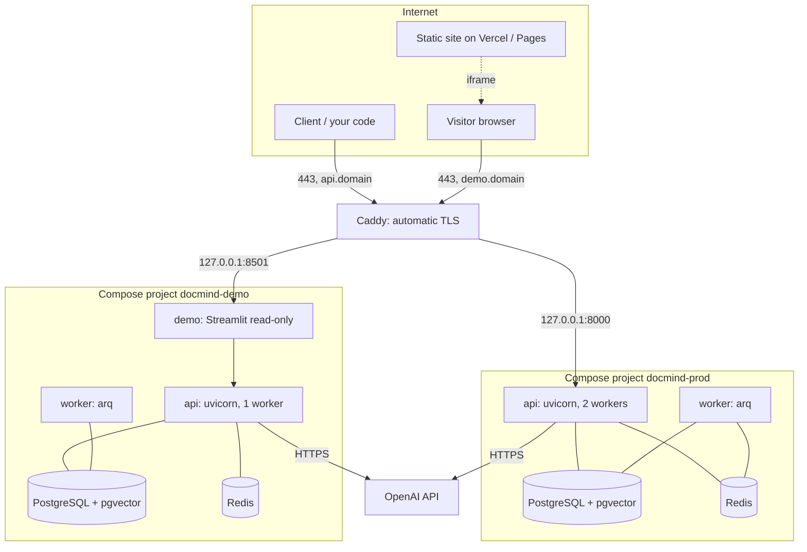

# DocMind — complete runbook: from an empty VPS to a public demo

A single step-by-step scenario for deploying the **production API** and the
**public demo** on one VPS, covering server hardening, DNS, secrets, GitHub,
TLS, budget, monitoring, backups, rollback and day-2 operations.

This document is the "do it by hand" procedure. Design decisions and their
rationale live in [`docs/DEPLOYMENT.md`](DEPLOYMENT.md) (production) and
[`docs/DEMO.md`](DEMO.md) (demo); here they are assembled into one linear
instruction.

> **Three rules that must never be broken.**
> 1. Secrets (`.env`, `.env.demo`, private keys, `OPENAI_API_KEY`) live only on
>    the server and in GitHub Secrets. Never in the repository and never in an
>    issue or a log.
> 2. Only 80/443 face the internet. Ports `8000`, `8001`, `8501`, `5432`, `6379`
>    are bound to loopback and are not opened in the firewall.
> 3. The demo contour never uses production secrets or the production database.

## Conventions used in this guide

| Placeholder | Meaning |
| --- | --- |
| `<domain>` | your domain, for example `example.com` |
| `api.<domain>` | public address of the production API |
| `demo.<domain>` | public address of the demo UI |
| `<VPS_IP>` | IPv4 address of your server |
| `deploy` | unprivileged user on the server |
| `/opt/docmind` | production contour directory (matches `DEPLOY_PATH` in GitHub) |
| `/opt/docmind-demo` | demo contour directory (a separate `DEPLOY_PATH`) |

Commands run on the server unless stated otherwise. Anything that needs root is
marked with `sudo`.

---

# Part 0. What the result looks like



| Component | Listens on | Who can reach it |
| --- | --- | --- |
| Production API | `127.0.0.1:8000` (loopback) | the internet via `api.<domain>` |
| Production DB/Redis | only the `docmind-prod_default` Docker network | nobody from outside |
| Demo API | `127.0.0.1:8001` (loopback) | nobody: the UI calls it from inside |
| Demo UI | `127.0.0.1:8501` (loopback) | the internet via `demo.<domain>` |
| Demo DB/Redis | only the `docmind-demo_default` Docker network | nobody from outside |

---

# Part 1. Requirements and capacity planning

## 1.1. What you need

- **VPS**: 2 vCPU / 4 GB RAM minimum for production. Production and demo together
  need about **7–8 GB** in the worst case (see below), so either take 8 GB or
  tighten the limits in [`docker-compose.demo.yml`](../docker-compose.demo.yml).
- **Disk**: 20 GB minimum. Account for images (~1.5 GB), the Postgres and uploads
  volumes, local backups (the last 5 dumps) and Caddy logs.
- **OS**: Ubuntu 22.04/24.04 LTS or Debian 12.
- **Domain** with the ability to create A/AAAA records.
- **GitHub**: administrative access to the repository (creating environments,
  secrets, variables).
- **OpenAI key** with a capped budget.
- **GHCR**: the private package is pulled from the VPS with a PAT.

## 1.2. Memory budget

| Service | Compose limit | Note |
| --- | --- | --- |
| prod `api` | 2 GB, 2 CPU | [`docker-compose.prod.yml`](../docker-compose.prod.yml) |
| prod `worker` | 2 GB, 2 CPU | same file |
| prod `db` | 2 GB, 2 CPU | same file |
| prod `redis` | 512 MB | same file |
| demo `api` | 1 GB, 1 CPU | [`docker-compose.demo.yml`](../docker-compose.demo.yml) |
| demo `worker` | 1 GB, 1 CPU | same file |
| demo `db` | 1 GB, 1 CPU | same file |
| demo `redis` | 256 MB | same file |
| demo `demo` (UI) | 512 MB | same file |

Worst case total: **~10.3 GB**. In practice Postgres/Redis rarely reach their
limits and real usage is usually 1.5–2 times lower. Still:

- With 4 GB, bring production up first, measure with `docker stats`, and only
  then shrink the demo (`api` 512 MB, `worker` 512 MB, `db` 512 MB, UI 384 MB).
- Add swap (step 6 of part 2): it will not save you from OOM loops, but it
  smooths out spikes.

## 1.3. Provider selection

| Provider | Advantages | Cost |
| --- | --- | --- |
| `openai` | no RAM requirement, fast, minimal setup | pays per traffic: a budget cap is mandatory |
| `ollama` | no monetary cost, data stays local | +8 GB RAM, slow first token, `EMBEDDING_DIM=768` and its own database |

For a public demo on a capped budget a sensible combination is **production and
demo on OpenAI**, but with different access keys and a hard limit in the
provider dashboard.

---

# Part 2. Initial VPS setup (steps 1–8)

## Step 1. First login and system update

```bash
ssh root@<VPS_IP>
apt update && apt full-upgrade -y
apt install -y curl git ufw fail2ban unzip ca-certificates jq
timedatectl set-timezone Europe/Budapest        # or your timezone
```

Check that only the services you need are enabled, and reboot if the kernel was
updated:

```bash
[ -f /var/run/reboot-required ] && reboot
```

## Step 2. The `deploy` user and an SSH key

```bash
adduser --gecos "" deploy
usermod -aG sudo deploy
```

On **your machine**, generate a key for logging in:

```bash
ssh-keygen -t ed25519 -C "docmind-admin" -f ~/.ssh/docmind_admin -N ""
ssh-copy-id -i ~/.ssh/docmind_admin.pub deploy@<VPS_IP>
ssh deploy@<VPS_IP>     # verify the login
```

## Step 3. SSH hardening

**Do not close the current session** until you have confirmed the new login
works.

```bash
sudo tee /etc/ssh/sshd_config.d/99-hardening.conf >/dev/null <<'EOF'
PermitRootLogin no
PasswordAuthentication no
PubkeyAuthentication yes
KbdInteractiveAuthentication no
X11Forwarding no
MaxAuthTries 3
LoginGraceTime 20
EOF
sudo sshd -t && sudo systemctl reload ssh
```

Check from a **new** terminal: `ssh deploy@<VPS_IP>` must succeed and
`ssh root@<VPS_IP>` must be refused.

## Step 4. Firewall

```bash
sudo ufw default deny incoming
sudo ufw default allow outgoing
sudo ufw allow OpenSSH
sudo ufw allow 80/tcp
sudo ufw allow 443/tcp
sudo ufw allow 443/udp      # only if you enable HTTP/3 in Caddy
sudo ufw enable
sudo ufw status verbose
```

> Ports 8000 and 8001 are **never opened**: they are bound to loopback and are
> reachable only by processes on the server itself.

## Step 5. Brute-force protection

```bash
sudo tee /etc/fail2ban/jail.d/sshd.local >/dev/null <<'EOF'
[sshd]
enabled = true
maxretry = 4
findtime = 10m
bantime  = 1h
EOF
sudo systemctl enable --now fail2ban
sudo fail2ban-client status sshd
```

Automatic security updates:

```bash
sudo dpkg-reconfigure --priority=low unattended-upgrades
```

## Step 6. Swap

```bash
sudo fallocate -l 4G /swapfile
sudo chmod 600 /swapfile
sudo mkswap /swapfile
sudo swapon /swapfile
echo '/swapfile none swap sw 0 0' | sudo tee -a /etc/fstab
free -h
```

With 8+ GB of RAM, 2 GB is enough. `vm.swappiness=10` reduces unnecessary
swapping.

## Step 7. Docker Engine and Compose

```bash
sudo install -m 0755 -d /etc/apt/keyrings
curl -fsSL https://download.docker.com/linux/ubuntu/gpg \
  | sudo gpg --dearmor -o /etc/apt/keyrings/docker.gpg
sudo chmod a+r /etc/apt/keyrings/docker.gpg
echo "deb [arch=$(dpkg --print-architecture) signed-by=/etc/apt/keyrings/docker.gpg] \
https://download.docker.com/linux/ubuntu $(. /etc/os-release && echo $VERSION_CODENAME) stable" \
  | sudo tee /etc/apt/sources.list.d/docker.list >/dev/null
sudo apt update
sudo apt install -y docker-ce docker-ce-cli containerd.io \
  docker-buildx-plugin docker-compose-plugin
sudo usermod -aG docker deploy
```

Log out and back in (so the `docker` group applies), then verify:

```bash
docker --version && docker compose version
docker run --rm hello-world
```

**Daemon-level log rotation** (the Compose files already set it per service;
this is a safety net for containers you do not own):

```bash
sudo tee /etc/docker/daemon.json >/dev/null <<'EOF'
{
  "log-driver": "json-file",
  "log-opts": { "max-size": "10m", "max-file": "3" }
}
EOF
sudo systemctl restart docker
```

## Step 8. Operations utilities

```bash
sudo apt install -y rclone postgresql-client-16 || sudo apt install -y rclone postgresql-client
```

- `rclone` — off-host backup upload (wired in through `BACKUP_SYNC_CMD`).
- `psql` on the host is handy for manual database checks but is not required:
  Compose can run `exec -T db psql`.

Optional:

```bash
git config --global user.email "ops@<domain>"
git config --global user.name "DocMind Ops"
```

---

# Part 3. DNS

Create the records at your registrar or DNS provider:

| Type | Name | Value | TTL |
| --- | --- | --- | --- |
| A | `api` | `<VPS_IP>` | 300 |
| A | `demo` | `<VPS_IP>` | 300 |
| AAAA | `api` / `demo` | IPv6, if available | 300 |

Verify:

```bash
dig +short api.<domain>
dig +short demo.<domain>
```

> **Order matters.** Caddy obtains its certificate over ACME (HTTP-01/TLS-ALPN),
> so DNS must resolve **before** Caddy starts for the first time and 80/443 must
> be open. Otherwise you get an issuance error and a temporary ban from Let's
> Encrypt.

---

# Part 4. Directories

```bash
sudo mkdir -p /opt/docmind /opt/docmind-demo/corpus
sudo chown -R deploy:deploy /opt/docmind /opt/docmind-demo
```

The Caddy log directory is deliberately **not** created here: the `caddy` user
appears only after the package is installed (part 10).

Why two directories: each contour has **its own `DEPLOY_PATH`**, its own env
file, its own state file and its own backups. Mixing the directories is the one
mistake that can make a demo deployment overwrite production deployment files.

---

# Part 5. The server-side `.env` for production

## 5.1. Generating secrets

```bash
openssl rand -hex 32     # Postgres password
openssl rand -hex 32     # Redis password
openssl rand -hex 48     # API_KEY (the shared API secret)
```

Store them in a password manager: they cannot be recovered.

## 5.2. Creating the file

```bash
cd /opt/docmind
umask 077
nano .env
```

```dotenv
# --- PostgreSQL ---
POSTGRES_USER=docmind
POSTGRES_PASSWORD=<generated-32-byte-password>
POSTGRES_DB=docmind

# --- Redis ---
REDIS_PASSWORD=<generated-32-byte-password>

# --- API ---
API_KEY=<generated-48-byte-key>
ENVIRONMENT=production
ENABLE_DOCS=False
METRICS_ENABLED=True
LOG_JSON=True
LOG_LEVEL=INFO
CORS_ORIGINS=https://app.<domain>

# --- Provider ---
EMBEDDING_PROVIDER=openai
LLM_PROVIDER=openai
EMBEDDING_DIM=1536
OPENAI_API_KEY=<provider-key>

# --- Optional ---
# MAX_UPLOAD_MB=25
# LLM_REASONING_EFFORT=none
# RATE_LIMIT_WINDOW_SECONDS=60
# UPLOAD_RATE_LIMIT_REQUESTS=10
# CHAT_RATE_LIMIT_REQUESTS=30
# DB_POOL_SIZE=10
# DB_MAX_OVERFLOW=10
# FORWARDED_ALLOW_IPS=172.16.0.0/12
# BACKUP_SYNC_CMD=rclone copy --no-transfer
```

Then:

```bash
chmod 600 /opt/docmind/.env
grep -c '=' /opt/docmind/.env     # sanity check: the file is not empty
```

## 5.3. Rules enforced by the system

| Rule | Enforced by | Consequence of a violation |
| --- | --- | --- |
| `API_KEY` is mandatory | [`src/config.py`](../src/config.py) | the API refuses to start |
| `CORS_ORIGINS` is not `*` in production | [`src/config.py`](../src/config.py) | the API refuses to start |
| `EMBEDDING_DIM` matches the model **and** the migration | [`src/db/schema_guard.py`](../src/db/schema_guard.py) | startup fails instead of corrupting data |
| `DATABASE_URL`/`REDIS_URL` are not `localhost` | [`remote-deploy.sh`](../.github/deploy/remote-deploy.sh) | the rollout stops before changing anything |
| `POSTGRES_PASSWORD` and friends are mandatory | [`docker-compose.prod.yml`](../docker-compose.prod.yml) | `docker compose` will not start |

## 5.4. Database connection pool

The formula from the README: `(API workers + 1) * (DB_POOL_SIZE + DB_MAX_OVERFLOW) < max_connections`.

Production: 2 workers + 1 arq worker = `3 * (10 + 10) = 60` < `max_connections=100`.
If you add workers, shrink the pool or raise `max_connections` (the Postgres
default is 100, and so is the pgvector image's).

---

# Part 6. GitHub: key, PAT, environments

## 6.1. Deploy key

On **your machine**:

```bash
ssh-keygen -t ed25519 -C "github-actions-deploy" -f ~/.ssh/docmind_deploy -N ""
ssh-copy-id -i ~/.ssh/docmind_deploy.pub deploy@<VPS_IP>
cat ~/.ssh/docmind_deploy      # private key -> GitHub Secret SSH_KEY
```

### 6.1.1. If the key has a passphrase

A key without a passphrase (`-N ""`, as above) is the preferred option: the
GitHub Secret protects it, and `SSH_PASSPHRASE` is not needed at all.

If the key was created with a passphrase anyway, the passphrase is stored as a
**separate** secret, not inside `SSH_KEY`:

```bash
gh secret set SSH_PASSPHRASE --env production
gh secret set SSH_PASSPHRASE --env demo
```

`Deploy Production` and `Deploy Demo` pass it to `appleboy/scp-action` and
`appleboy/ssh-action` through the `passphrase` input. Without that secret
`drone-scp` opens the TCP connection and detects the server OS, but cannot
authenticate:

```
ssh.ParsePrivateKey: ssh: this private key is passphrase protected
ssh: handshake failed: ssh: unable to authenticate, attempted methods [none],
no supported methods remain
```

`attempted methods [none]` is the important detail: the list of authentication
methods is empty, which means the key never loaded at all. The server is not
involved here, and neither is `authorized_keys`: the comparison never happens.

Verify the "key + passphrase" pair before pushing:

```bash
ssh-keygen -y -P "$SSH_PASSPHRASE" -f ~/.ssh/docmind_deploy > /tmp/docmind.pub
ssh-keygen -lf /tmp/docmind.pub        # the fingerprint that must exist on the server
```

On the VPS: `ssh-keygen -lf ~/.ssh/authorized_keys` — the fingerprints must
match. The `Validate SSH deploy key` diagnostic step in both workflows prints
the same value, so you can compare straight from the Actions log.

## 6.2. GHCR token

Create a **Personal Access Token**:

- classic: the `read:packages` scope;
- or fine-grained: Packages access (read).

`GHCR_USER` is your GitHub login. It is **not a secret**: it appears in the
repository name, in the clone URL and in the image path `ghcr.io/<login>/docmind`.
That is why it lives in Variables, not Secrets: GitHub masks a secret value in
every log line, and when the login is part of the domain, `environment.url` is
not published either — the job ends with `Skip setting environment url … may
contain secret`.

`GHCR_PULL_TOKEN` is the token itself; on the VPS it is used only for
`docker login ghcr.io` and `docker pull`.

## 6.3. Environment `production`

| Kind | Name | Value |
| --- | --- | --- |
| Environment | `production` | Required reviewers: you/your team (manual approve) |
| Secret | `SSH_HOST` | `<VPS_IP>` |
| Secret | `SSH_USER` | `deploy` |
| Secret | `SSH_KEY` | the whole private key, with `-----BEGIN…/END…-----` |
| Secret | `SSH_PASSPHRASE` | passphrase for `SSH_KEY`; **not needed** when the key has none |
| Secret | `SSH_PORT` | `22` (or yours) |
| Secret | `DEPLOY_PATH` | `/opt/docmind` |
| Variable | `GHCR_USER` | GitHub login; **not** a secret (see 6.2) |
| Secret | `GHCR_PULL_TOKEN` | access to the private image |
| Variable | `PRODUCTION_URL` | `https://api.<domain>` |

## 6.4. Environment `demo`

| Kind | Name | Value |
| --- | --- | --- |
| Environment | `demo` | **without** required reviewers |
| Secret | `SSH_HOST`, `SSH_USER`, `SSH_KEY`, `SSH_PORT` | the same access |
| Secret | `SSH_PASSPHRASE` | passphrase of the **demo** key; contour secrets are never reused |
| Secret | `DEPLOY_PATH` | `/opt/docmind-demo` |
| Variable | `GHCR_USER` | the same login |
| Secret | `GHCR_PULL_TOKEN` | the same token |
| Variable | `DEMO_URL` | `https://demo.<domain>` |

> If `SSH_HOST` is missing, the job fails with an explicit error instead of
> silently skipping the deployment. If the demo `DEPLOY_PATH` points at
> `/opt/docmind`, the demo rollout starts managing the production stack — the one
> configuration mistake that really breaks production.

---

# Part 7. The first image release

## 7.1. Local gates before merge

```bash
make install      # python -m pip install -e ".[dev,demo]" + pre-commit hooks
make check        # ruff + ruff format --check + mypy + pytest with a 60% gate
```

## 7.2. What CI runs

[`ci.yml`](../.github/workflows/ci.yml) on every PR:

- **lint**: `ruff check` and `ruff format --check`;
- **typecheck**: `mypy src`;
- **test**: `pytest --cov=src --cov-fail-under=60`;
- **migrations-and-integration**: `alembic upgrade head`, `alembic check`
  (schema drift detection) and `pytest -m integration` against a live pgvector.

Plus [`security.yml`](../.github/workflows/security.yml) (CodeQL, pip-audit,
gitleaks, Trivy FS) and [`dependency-review.yml`](../.github/workflows/dependency-review.yml).

## 7.3. Publishing images

```bash
git checkout main && git pull
git tag v1.0.0
git push origin v1.0.0
```

Two independent workflows start:

| Workflow | Image | Gate |
| --- | --- | --- |
| [`release-image.yml`](../.github/workflows/release-image.yml) | `ghcr.io/<owner>/<repo>` | Trivy HIGH/CRITICAL, SBOM + provenance |
| [`release-demo-image.yml`](../.github/workflows/release-demo-image.yml) | `ghcr.io/<owner>/<repo>-demo` | the same gate, in a separate workflow |

The split is deliberate: a CVE in the Streamlit stack must not block a
production release. The `sha-<full-sha>` tag (`type=sha,format=long`) exists on
both images — deployments resolve the digest from it.

If the Trivy gate fails: read the report in the job log, update the dependency or
the base image, then re-run the workflow. Do not disable the gate — digest
pinning protects against substitution, not against vulnerable code.

---

# Part 8. The first production deployment

1. Open Actions → **Deploy Production**.
2. If this is a post-release run, click **Review deployments → Approve**.
   Alternatively run it manually (`workflow_dispatch`) and pass `image_tag`
   (for example `sha-<full-sha>` or `v1.0.0`).
3. What happens on the server ([`remote-deploy.sh`](../.github/deploy/remote-deploy.sh)):

| Stage | Action | Why |
| --- | --- | --- |
| 0 | Refuse to continue if `DATABASE_URL`/`REDIS_URL` point at localhost | otherwise the container goes to its own loopback and dies |
| 1 | `docker login`, `docker pull`, resolve the `repo@sha256:...` digest | an immutable reference instead of a mutable tag |
| 2 | `compose up -d --wait db redis` | backing services must be healthy |
| 3 | Mandatory `pg_dump` into `backups/predeploy-*.sql` | migrations are not applied without a backup |
| 3b | `--profile ollama` + `ollama-init` | only when Ollama is selected |
| 4 | `alembic upgrade head` **once**, outside container startup | a restart can never change the schema |
| 5 | `compose up -d --no-build api worker` | traffic switch |
| 5a | Wait for `/health` up to 36 attempts × 5 s = 3 minutes | otherwise automatic rollback |
| 5b | `POST_DEPLOY_CMD`, when set | empty for production; seed for the demo |
| 6 | Write the tag to `.deployed_image_tag` | the basis for a rollback |

4. **First deployment**: there is no previous tag, so automatic rollback is not
   available — the script logs that explicitly. Keep an SSH session at hand.

Expected log lines: `deploying ghcr.io/...@sha256:...`,
`database backed up to backups/predeploy-...sql`, `applying database migrations`,
`health check passed`.

---

# Part 9. Production verification

```bash
cd /opt/docmind
set -a; . ./.env; set +a          # pull the .env variables into the current session

curl -fsS http://127.0.0.1:8000/health | jq .
```

Expected fields ([`src/schemas/meta.py`](../src/schemas/meta.py)):

```json
{"status":"healthy","database":true,"redis":true,"version":"1.0.0",
 "environment":"production","provider_ready":true}
```

`status` may be `degraded` (the response is 503 then) — that means Postgres or
Redis is not answering.

Check authorization and data:

```bash
# without a key — 401
curl -sS -o /dev/null -w '%{http_code}\n' http://127.0.0.1:8000/api/v1/documents

# with a key — 200 and the list
curl -fsS -H "X-API-Key: $API_KEY" http://127.0.0.1:8000/api/v1/documents | jq .

# metrics are readable from the host itself
curl -fsS http://127.0.0.1:8000/metrics | head -n 20

# version of the deployed image
cat .deployed_image_tag
docker compose -f docker-compose.prod.yml ps
```

End-to-end test (upload → indexing → chat):

```bash
printf 'DocMind is a RAG service for documents. Test document.\n' > /tmp/sample.txt

DOC_ID=$(curl -fsS -H "X-API-Key: $API_KEY" \
  -F "file=@/tmp/sample.txt" \
  http://127.0.0.1:8000/api/v1/documents/upload | jq -r .id)
echo "$DOC_ID"

# wait until the status becomes completed
watch -n 3 "curl -fsS -H 'X-API-Key: $API_KEY' \
  http://127.0.0.1:8000/api/v1/documents/$DOC_ID/status | jq '{status, chunk_count}'"

# streaming answer: tokens must appear gradually, not as one block
curl -sSN -H "X-API-Key: $API_KEY" -H 'Content-Type: application/json' \
  -d "{\"query\":\"What is this document about?\",\"document_ids\":[\"$DOC_ID\"]}" \
  http://127.0.0.1:8000/api/v1/chat/completions
```

Remove the test document so it does not end up in the production corpus:

```bash
curl -fsS -X DELETE -H "X-API-Key: $API_KEY" \
  http://127.0.0.1:8000/api/v1/documents/$DOC_ID
```

---

# Part 10. Caddy: TLS and vhosts

## 10.1. Installation

```bash
sudo apt install -y debian-keyring debian-archive-keyring apt-transport-https
curl -1sLf 'https://dl.cloudsmith.io/public/caddy/stable/gpg.key' \
  | sudo gpg --dearmor -o /usr/share/keyrings/caddy-stable-archive-keyring.gpg
curl -1sLf 'https://dl.cloudsmith.io/public/caddy/stable/debian.deb.txt' \
  | sudo tee /etc/apt/sources.list.d/caddy-stable.list
sudo apt update && sudo apt install -y caddy
```

## 10.2. Configuration

Start with the log directory: Caddy runs as the `caddy` user, which appears only
after the package is installed, and without permissions on that directory the
service will not start.

```bash
sudo mkdir -p /var/log/caddy
sudo chown -R caddy:caddy /var/log/caddy
```

> **Trap.** `sudo caddy validate` (like any `caddy run`/`caddy reload` as root)
> **creates** the files declared by the `log` directive as `root` with `0600`
> permissions. After that `systemctl reload caddy` fails with
> `open /var/log/caddy/docmind-api.log: permission denied` and `status_code:400`
> from the admin API, even though `validate` reports `Valid configuration`.
> Fix it once and for all:
>
> ```bash
> sudo chown caddy:caddy /var/log/caddy/*.log
> ```
>
> A later `validate` run from `sudo` is safe: root opening an existing file does
> not change its owner.

Take [`deploy/caddy/Caddyfile.example`](../deploy/caddy/Caddyfile.example) as
the basis:

```bash
sudo cp /opt/docmind/deploy/caddy/Caddyfile.example /etc/caddy/Caddyfile   # if the file exists on the server
sudo nano /etc/caddy/Caddyfile
```

Replace: `email` with a real address, `api.example.com` → `api.<domain>`,
`demo.example.com` → `demo.<domain>`. Key parts of the configuration:

| Block | Why |
| --- | --- |
| `request_body { max_size 30MB }` | slightly above `MAX_UPLOAD_MB=25`, otherwise the multipart envelope truncates a valid file |
| `handle /health` | public probe without a key; accepts `GET` and `HEAD` |
| `handle /metrics` + `remote_ip` | `/metrics` is served **without authorization** — it must not face the internet |
| `handle /api/v1/chat/completions` + `flush_interval -1` | without it SSE arrives as one block at the end |
| `header_up X-Forwarded-For {remote_host}` | an explicit **overwrite**, not an append. Redundant on Caddy ≥ 2.7 (an incoming header from an untrusted peer is ignored), but harmless and remains a safety net if `trusted_proxies` is extended later |
| `log { output file ... { roll_size / roll_keep } }` | the name enters Certificate Transparency and scanners follow immediately: without rotation the log grows without bound |
| demo vhost: `read_timeout 0` | the Streamlit WebSocket must not die on a timeout |
| demo vhost: no `X-Frame-Options` | the page is embedded in an iframe on the site |

> The WARN `Unnecessary header_up X-Forwarded-For/Proto` printed by
> `caddy validate` is **expected noise** on Caddy ≥ 2.7, and
> `Caddyfile input is not formatted` is fixed by
> `sudo caddy fmt --overwrite /etc/caddy/Caddyfile`. Neither prevents the config
> from loading.

## 10.3. Starting and checking

```bash
sudo caddy validate --config /etc/caddy/Caddyfile
sudo systemctl enable --now caddy
sudo systemctl reload caddy
sudo journalctl -u caddy -n 50 --no-pager
```

Checks:

```bash
curl -sS -o /dev/null -w '%{http_code}\n' https://api.<domain>/health      # expect 200
curl -sS  https://api.<domain>/health | jq .
curl -sSI https://api.<domain>/health | head -n 3                          # HEAD is allowed too
curl -sS -o /dev/null -w '%{http_code}\n' https://api.<domain>/metrics    # expect 404
curl -sS -o /dev/null -w '%{http_code}\n' \
  -H "X-API-Key: $API_KEY" https://api.<domain>/api/v1/documents          # expect 200
```

> `/health` accepts both `GET` and `HEAD` ([`src/main.py`](../src/main.py)). If a
> monitor sends `HEAD` and receives `405`, an old build is deployed: such a probe
> looks like "the service is down" while the API is fully alive.

To verify that the real client IP reaches the application, ask someone outside to
call the API and confirm that the Caddy JSON log shows their address in
`client_ip`, not `127.0.0.1`.

## 10.4. If the certificate is not issued

| Symptom | Cause |
| --- | --- |
| `no such host` / NXDOMAIN | the A record was not created or has not propagated |
| `connection refused` | 80/443 are closed in `ufw` or at the provider |
| `rate limited` | too many attempts within 7 days: wait or use the staging CA |
| A valid response but a certificate warning | the certificate is still being obtained; check `journalctl -u caddy` |

## 10.5. If a vhost returns 502

`dial tcp 127.0.0.1:8501: connect: connection refused` in
`/var/log/caddy/*.log` means the **upstream is not running**, not a Caddy bug:
check `ss -lntp | grep -E ':(8000|8501)\b'`. If the demo contour is not needed on
this VPS, remove the demo vhost — otherwise every internet scanner (`/.env`,
`/.git/config`, `/wp-json/`, `/graphql`) keeps filling the log. The
`roll_size`/`roll_keep` rotation in
[`deploy/caddy/Caddyfile.example`](../deploy/caddy/Caddyfile.example) bounds its
size, but does not remove the noise.

---

# Part 11. The demo contour

## 11.1. Preparation

```bash
mkdir -p /opt/docmind-demo/corpus
# put 2-3 documents there that you do not mind showing publicly
cp /path/to/*.pdf /opt/docmind-demo/corpus/
ls -la /opt/docmind-demo/corpus
```

Supported suffixes: `.txt`, `.md`, `.csv`, `.json`, `.pdf`
([`src/services/parser.py`](../src/services/parser.py)).

## 11.2. Its own `.env.demo`

```bash
cd /opt/docmind-demo
umask 077
nano .env.demo
```

```dotenv
# --- PostgreSQL (a database of its own!) ---
POSTGRES_USER=docmind_demo
POSTGRES_PASSWORD=<separate-password>
POSTGRES_DB=docmind_demo

# --- Redis ---
REDIS_PASSWORD=<separate-password>

# --- API: THE KEY MUST DIFFER FROM THE PRODUCTION ONE ---
API_KEY=<separate-demo-key>

CORS_ORIGINS=https://demo.<domain>
DOCMIND_PUBLIC_API_URL=https://demo.<domain>

EMBEDDING_PROVIDER=openai
LLM_PROVIDER=openai
EMBEDDING_DIM=1536
OPENAI_API_KEY=<provider-key-for-the-demo>

ENABLE_DOCS=False
METRICS_ENABLED=True

# --- Budget protection and sensible limits ---
RATE_LIMIT_WINDOW_SECONDS=60
CHAT_RATE_LIMIT_REQUESTS=5
UPLOAD_RATE_LIMIT_REQUESTS=10
FORWARDED_ALLOW_IPS=172.16.0.0/12

DOCMIND_DEMO_MAX_QUESTION_CHARS=500
DOCMIND_DEMO_TOP_K=4
SEED_WAIT_SECONDS=180
```

```bash
chmod 600 /opt/docmind-demo/.env.demo
```

> **Why `--env-file .env.demo` is mandatory in every command.**
> Compose resolves `${VAR:?...}` only from the process environment, from a file
> passed with `--env-file`, or from a file named exactly `.env` in the project
> directory. The `env_file:` sections in
> [`docker-compose.demo.yml`](../docker-compose.demo.yml) populate the container
> environment and are applied **after** interpolation, so on their own they do
> not satisfy `POSTGRES_PASSWORD`/`API_KEY`/`REDIS_PASSWORD`. The production
> contour hid this because `ENV_FILE=.env` matches the file Compose loads on its
> own; without the flag Compose prints one
> `required variable … is missing a value` error per service for the demo. The
> deploy script passes the flag itself; manual commands must pass it explicitly.

## 11.3. Deploying the demo

Automatically after a successful `Release Demo Image`, or manually:
Actions → **Deploy Demo** → Run workflow → `image_tag`.

The sequence of steps is the same, with different parameters:

| Parameter | Demo |
| --- | --- |
| `COMPOSE_FILE` | `docker-compose.demo.yml` |
| `ENV_FILE` | `.env.demo` |
| `STATE_FILE` | `.deployed_demo_image_tag` |
| `BACKUP_DIR` | `backups-demo` |
| `HEALTH_URL` | `http://localhost:8001/health` |
| `TRAFFIC_SERVICES` | `api worker demo` |
| `POST_DEPLOY_CMD` | `docker compose -f docker-compose.demo.yml --env-file .env.demo --profile seed run --rm demo-seed` |

The script [`remote-deploy.sh`](../.github/deploy/remote-deploy.sh) adds
`--env-file "${ENV_FILE}"` to every Compose invocation and runs
`compose config --quiet` before `docker login`: if `.env.demo` is missing,
unreadable or short of a variable, the rollout fails with a clear message
without touching the running contour.

## 11.4. Verifying the demo

```bash
cd /opt/docmind-demo
set -a; . ./.env.demo; set +a

curl -fsS http://127.0.0.1:8001/health | jq .
curl -fsS http://127.0.0.1:8501/_stcore/health && echo "  UI ok"
curl -fsS -H "X-API-Key: $API_KEY" http://127.0.0.1:8001/api/v1/documents \
  | jq -r '.[] | "\(.filename)\t\(.status)\t\(.chunk_count) chunks"'
```

In a browser: `http://127.0.0.1:8501` must show the document list and the chat
tab; there must be no upload widget.

## 11.5. Manual seed and corpus updates

After adding files:

```bash
cd /opt/docmind-demo
docker compose -f docker-compose.demo.yml --env-file .env.demo \
  --profile seed run --rm demo-seed
```

The script is idempotent: documents already indexed by filename are skipped, and
each new one is awaited until it reaches `completed`.

## 11.6. Full demo reset

```bash
cd /opt/docmind-demo
docker compose -f docker-compose.demo.yml --env-file .env.demo down
docker volume rm docmind-demo_demo_pg_data docmind-demo_demo_uploads
# the next deployment recreates the schema and re-seeds the corpus
```

---

# Part 12. Embedding the demo on the site

```html
<iframe
  src="https://demo.<domain>/?embed=true"
  title="DocMind live demo"
  width="100%"
  height="820"
  style="border: 1px solid #d9d9d9; border-radius: 8px"
  loading="lazy"
  referrerpolicy="strict-origin-when-cross-origin"
  allow="clipboard-write"
></iframe>
<p>
  Demo not rendering?
  <a href="https://demo.<domain>/" target="_blank" rel="noopener">Open it in a new tab</a>.
</p>
```

Rules and pitfalls:

- `?embed=true` removes Streamlit's outer padding. Verify it on your version.
- Always keep a fallback link: corporate proxies, blockers and the parent page's
  CSP break iframes, and that is not your bug.
- HTTPS is mandatory on both sides: an HTTPS site will not embed an HTTP frame.
- To restrict who may embed it, set `frame-ancestors 'self' https://<your-site>`
  in Caddy instead of removing the protection.
- File uploads are **absent** from the UI, and questions are capped by
  `DOCMIND_DEMO_MAX_QUESTION_CHARS`.

How to check by hand:

1. Open `https://demo.<domain>/` directly — the document list is visible.
2. Pick a document, ask a question — the answer streams token by token and the
   sources are shown.
3. Ask a question longer than 500 characters — a warning must appear.
4. Open your site's page with the frame — the UI fits without being cropped.
5. Clear cookies or hard-reload — the session comes back up.

---

# Part 13. Proving the contours are isolated

Run this after the first demo deployment — all four checks must pass:

```bash
set -a; . /opt/docmind/.env; set +a
set -a; . /opt/docmind-demo/.env.demo; set +a

# 1. The demo key is rejected by the production API and vice versa
curl -sS -o /dev/null -w 'demo→prod: %{http_code}\n' \
  -H "X-API-Key: $API_KEY" http://127.0.0.1:8000/api/v1/documents
```

Careful: the two `.env` files overwrite the `API_KEY` variable. Check it this
way instead:

```bash
PROD_KEY=$(grep -E '^API_KEY=' /opt/docmind/.env | cut -d= -f2-)
DEMO_KEY=$(grep -E '^API_KEY=' /opt/docmind-demo/.env.demo | cut -d= -f2-)

# a key does not work against the other contour — both must return 401
curl -sS -o /dev/null -w 'prod key → demo API: %{http_code}\n' \
  -H "X-API-Key: $PROD_KEY" http://127.0.0.1:8001/api/v1/documents
curl -sS -o /dev/null -w 'demo key → prod API: %{http_code}\n' \
  -H "X-API-Key: $DEMO_KEY" http://127.0.0.1:8000/api/v1/documents

# 2. Different Compose projects and different volumes
docker ps --format '{{.Names}}' | sort
docker volume ls | grep docmind
docker network ls | grep docmind

# 3. No API port is published to the outside
sudo ss -tlnp | grep -E ':(8000|8001|8501|5432|6379)\b'
# every line must show 127.0.0.1

# 4. Restarting the demo does not touch production: container start times stay
docker compose -f /opt/docmind/docker-compose.prod.yml ps
docker compose -f /opt/docmind-demo/docker-compose.demo.yml ps
```

---

# Part 14. Budget, abuse and security

## 14.1. Provider spend

1. Set a **hard spend limit** for the project in the OpenAI dashboard.
2. Enable e-mail notifications about spending.
3. Keep `LLM_REASONING_EFFORT=none` (the project default): it is both cheaper and
   faster.
4. For the demo, use a cheaper model by setting `LLM_MODEL` in `.env.demo`.

Remember: the in-app limiter ([`src/api/deps.py`](../src/api/deps.py)) is
**process-local** and only smooths spikes. The real spending ceiling is the
provider account setting.

## 14.2. Request limits

| Setting | Production | Demo | Meaning |
| --- | --- | --- | --- |
| `RATE_LIMIT_WINDOW_SECONDS` | 60 | 60 | window |
| `CHAT_RATE_LIMIT_REQUESTS` | 30 | 5 | chat requests per client per window |
| `UPLOAD_RATE_LIMIT_REQUESTS` | 10 | 10 | uploads (in the demo only the seed performs them) |

Two important nuances:

- The limit is **per process**. Production with `--workers 2` effectively doubles
  it. The demo runs a single worker so the documented number matches reality.
- The limiter keys on the TCP peer address. Behind a proxy that is the Docker
  gateway, so production and the demo set `FORWARDED_ALLOW_IPS`, and Caddy
  **overwrites** `X-Forwarded-For`. With a proxy that appends to the header, a
  client could forge its IP and bypass the limit.

For a hard global limit: `caddy-ratelimit` or a CDN/WAF in front of the demo.

## 14.3. Secret hygiene

- `.env`, `.env.demo`, `.deployed_*`, `backups*`, `*.pem`, `*.key` are already in
  [`.gitignore`](../.gitignore); leak detection is done by gitleaks in
  [`security.yml`](../.github/workflows/security.yml).
- Rotating `API_KEY`: generate a new one, update `.env` (or `.env.demo`), then
  restart only `api worker` — no migrations are needed.
- Rotating `POSTGRES_PASSWORD`: change it in `.env` and in the database itself
  (`ALTER USER ... PASSWORD`), then restart `api worker`.
- Never reuse deploy keys between contours: if a key leaks, replacing `SSH_KEY`
  in GitHub and removing the old entry from `authorized_keys` is enough.

---

# Part 15. Monitoring and alerts

## 15.1. What to monitor

| What | Source | Alert when |
| --- | --- | --- |
| Liveness | `GET /health` (external monitor) | not 200 for more than 3 minutes |
| Readiness | `docmind_ready` == 1 | 0 for more than a minute |
| Chat errors | `docmind_chat_streams_total{outcome="error"}` | the error share grows |
| Indexing | `docmind_ingestion_jobs_total{outcome="failed"}` | it grows |
| Latency | `docmind_http_request_duration_seconds` | p95 grows |
| Resources | `docker stats`, `df -h` | disk > 80% |
| Spend | provider dashboard | approaching the cap |

Metric names come from [`src/metrics.py`](../src/metrics.py):
`docmind_http_requests_total`, `docmind_http_request_duration_seconds`,
`docmind_chat_streams_total`, `docmind_ingestion_jobs_total`, `docmind_ready`,
`docmind_app_info`.

## 15.2. Quick commands

```bash
# state and logs
docker compose -f /opt/docmind/docker-compose.prod.yml ps
docker compose -f /opt/docmind/docker-compose.prod.yml logs --since 30m api
docker compose -f /opt/docmind/docker-compose.prod.yml logs --since 30m worker
sudo journalctl -u caddy --since "30 min ago"

# metrics (only from the host or a private network)
curl -fsS http://127.0.0.1:8000/metrics | grep -E 'docmind_(ready|chat|ingestion)'

# resources
docker stats --no-stream
df -h /var/lib/docker
```

## 15.3. External monitoring

- Run Uptime Kuma / Healthchecks on another host and probe
  `https://api.<domain>/health` (it is public by design and needs no key).
- Configure the Prometheus scrape of `/metrics` over loopback or from a private
  network — Caddy closes it from the outside.
- Logs: JSON on stderr; collect `journalctl`/`docker logs` with your own stack.
  Correlate requests by the `X-Request-ID` header generated in
  [`src/main.py`](../src/main.py).

---

# Part 16. Backups and restore

## 16.1. What is already automated

Before every deployment the rollout performs a **mandatory** `pg_dump`:

```bash
ls -lh /opt/docmind/backups/ | tail
# predeploy-20261016T120000Z.sql
```

The dump is **not compressed** — it is plain SQL. The last `KEEP_BACKUPS=5` are
kept. If `pg_dump` fails, the deployment aborts: migrations are never applied
without a safety net.

## 16.2. Off-host copy

Configure rclone (`rclone config`) and add to `.env`:

```dotenv
BACKUP_SYNC_CMD=rclone copy --no-traverse
```

The script runs `rclone copy --no-traverse <backup_file>` — the file is copied to
the configured remote. Verify it explicitly, otherwise "there is a backup" stays
a hope.

## 16.3. Manual backup

```bash
cd /opt/docmind
set -a; . ./.env; set +a
mkdir -p backups
docker compose -f docker-compose.prod.yml exec -T db \
  sh -c 'pg_dump -U "$POSTGRES_USER" "$POSTGRES_DB"' \
  > "backups/manual-$(date -u +%Y%m%dT%H%M%SZ).sql"
ls -lh backups | tail -n 3
grep -c 'CREATE TABLE' backups/manual-*.sql | tail -n 1   # make sure the dump is not empty
```

## 16.4. Restore

The dump contains `CREATE TABLE` without `DROP`, so a restore targets an **empty**
database. The plan:

```bash
cd /opt/docmind
set -a; . ./.env; set +a
BACKUP=backups/predeploy-20261016T120000Z.sql

# 1. Stop traffic so nobody writes during the restore
docker compose -f docker-compose.prod.yml stop api worker

# 2. Recreate the database
docker compose -f docker-compose.prod.yml exec -T db \
  sh -c 'psql -U "$POSTGRES_USER" -d postgres -c "DROP DATABASE IF EXISTS \"$POSTGRES_DB\" WITH (FORCE);"'
docker compose -f docker-compose.prod.yml exec -T db \
  sh -c 'psql -U "$POSTGRES_USER" -d postgres -c "CREATE DATABASE \"$POSTGRES_DB\";"'

# 3. Restore the schema and the data (the dump is NOT compressed — no gunzip)
docker compose -f docker-compose.prod.yml exec -T db \
  sh -c 'psql -U "$POSTGRES_USER" -d "$POSTGRES_DB"' < "$BACKUP"

# 4. Bring the stack up and confirm the schema is there
docker compose -f docker-compose.prod.yml up -d --no-build api worker
curl -fsS http://127.0.0.1:8000/health | jq .
```

If the `vector` extension was not created automatically, enable it as a
superuser and repeat step 3:

```bash
docker compose -f docker-compose.prod.yml exec -T db \
  sh -c 'psql -U "$POSTGRES_USER" -d "$POSTGRES_DB" -c "CREATE EXTENSION IF NOT EXISTS vector;"'
```

Restoring the demo contour uses the same commands with `-f docker-compose.demo.yml`,
`/opt/docmind-demo` and `backups-demo`.

## 16.5. Drill

Once a quarter: start a test Postgres, restore the latest dump, confirm that
`alembic current` matches the expected revision and that the API starts against
the restored database. A backup that has never been restored is not a backup.

---

# Part 17. Updates, migrations, rollback

## 17.1. Normal release

1. You merged the PR into `main` (CI must be green).
2. `Release Image` built and published the image (and `Release Demo Image` its
   own).
3. Actions → `Deploy Production` → **Approve**.
4. Rollout: backup → migrations → restart `api worker` → health → state.
5. The demo follows automatically (`Deploy Demo`), then the seed runs.

## 17.2. Migrations: expand/contract only

The schema is **not** rolled back together with the image. Rule: every release
must be compatible with both the old and the new schema version.

| Bad | Good |
| --- | --- |
| Renaming a column in one release | Add a new one → write to both → migrate the data → drop the old one in the next release |
| Adding `NOT NULL` without a default | Add it with a default, then drop the default |
| Dropping a table while old code is still live | Ship code without those reads first, then drop |

Verify locally: `alembic upgrade head && alembic check` — CI does the same.

## 17.3. Automatic rollback

If `/health` does not come up within 3 minutes, the script tries to restore the
previous tag from `.deployed_image_tag` — **but only if** that image understands
the current database revision (`alembic history` contains it). Otherwise it
refuses and asks for manual intervention: a blind rollback turns the API into a
crash loop.

## 17.4. Manual rollback

```bash
# option 1: re-run the rollout with the previous tag
# Actions → Deploy Production → Run workflow → image_tag: <previous-tag>

# option 2: on the server
cd /opt/docmind
# see what was deployed
cat .deployed_image_tag
# edit the state and restart the services by hand
echo "<previous-tag>" > .deployed_image_tag
```

Rolling back the **schema** is only possible by restoring a dump (see part 16)
plus shipping the old image. That is why a backup before every deployment is
unconditional.

## 17.5. Rolling back the demo

The same procedure, but with `DEPLOY_PATH=/opt/docmind-demo`, the state file
`.deployed_demo_image_tag` and backups in `backups-demo`. Rolling back the demo
does not affect production.

---

# Part 18. Routine operations

## 18.1. What happens on its own

- **Dependabot**: PRs for pip / actions / docker.
- **Weekly Trivy**: [`security.yml`](../.github/workflows/security.yml).
- **APT_CACHE_BUST**: the apt layer is rebuilt on every release, so the image
  never carries stale Debian patches.
- **Pre-deploy backup**: before every migration.
- **Backup retention**: the last 5 are kept.

## 18.2. What to do by hand

| Cadence | Action |
| --- | --- |
| Weekly | Review Dependabot PRs; `docker system df`; check the alerts |
| Monthly | `sudo apt upgrade -y`, reboot when the kernel is updated; `docker image prune -f`; check free space |
| Quarterly | Restore a dump on a test container; rotate `API_KEY`; rotate the GHCR PAT |
| On an incident | Rotate the affected secrets; audit `journalctl`/Caddy logs by `X-Request-ID` |

## 18.3. Disk maintenance

```bash
df -h
docker system df
docker image prune -f          # safe: removes unused images
docker builder prune -f        # build cache
ls -lh /opt/docmind/backups /opt/docmind-demo/backups-demo
```

> Do **not** run `docker volume prune`: it can delete `docmind-prod_pg_data`.
> To remove a volume, name it explicitly, as in the demo reset section.

---

# Appendix A. Command cheat sheet

```bash
# --- Production ---
cd /opt/docmind
set -a; . ./.env; set +a
docker compose -f docker-compose.prod.yml ps
docker compose -f docker-compose.prod.yml logs -f api
docker compose -f docker-compose.prod.yml restart api worker
curl -fsS http://127.0.0.1:8000/health | jq .

# --- Demo ---
cd /opt/docmind-demo
set -a; . ./.env.demo; set +a
docker compose -f docker-compose.demo.yml ps
docker compose -f docker-compose.demo.yml --profile seed run --rm demo-seed
curl -fsS http://127.0.0.1:8001/health | jq .

# --- Caddy ---
sudo caddy validate --config /etc/caddy/Caddyfile
sudo systemctl reload caddy && sudo journalctl -u caddy -n 30 --no-pager

# --- Public checks ---
curl -sS https://api.<domain>/health | jq .
curl -sS -H "X-API-Key: $API_KEY" https://api.<domain>/api/v1/documents | jq .
curl -sSI https://demo.<domain>/ | head -n 3
```

# Appendix B. Environment variables

| Variable | Required | Where | Purpose |
| --- | --- | --- | --- |
| `POSTGRES_USER/PASSWORD/DB` | yes | both `.env` files | database credentials (Compose requires them) |
| `REDIS_PASSWORD` | yes | both `.env` files | enables `requirepass` |
| `API_KEY` | yes in production | both `.env` files | key for all of `/api/v1/*`; a separate one in the demo |
| `EMBEDDING_DIM` | yes | both `.env` files | vector width; must match the model and the migration |
| `CORS_ORIGINS` | yes | both `.env` files | explicit list, not `*` |
| `OPENAI_API_KEY` | with `openai` | both `.env` files | provider access |
| `ENVIRONMENT` | — | compose | `production` enables the strict policy |
| `ENABLE_DOCS` | — | both `.env` files | Swagger; `False` in production |
| `METRICS_ENABLED` | — | both `.env` files | enables `/metrics` |
| `MAX_UPLOAD_MB` | — | both `.env` files | file size limit (25 by default) |
| `LLM_MODEL` / `EMBEDDING_MODEL` | — | both `.env` files | model override |
| `LLM_REASONING_EFFORT` | — | both `.env` files | `none` by default: cheaper |
| `RATE_LIMIT_*` | — | both `.env` files | per-client limits |
| `FORWARDED_ALLOW_IPS` | — | compose | trusted addresses for `X-Forwarded-For` |
| `DB_POOL_SIZE` / `DB_MAX_OVERFLOW` | — | both `.env` files | pool size (see the formula) |
| `BACKUP_SYNC_CMD` | — | production | off-host backup upload |
| `DOCMIND_PUBLIC_API_URL` | yes in the demo | `.env.demo` | public origin of the demo |
| `DOCMIND_DEMO_MODE` | — | compose | read-only mode of the UI |
| `DOCMIND_DEMO_MAX_QUESTION_CHARS` | — | `.env.demo` | question length limit |
| `DOCMIND_DEMO_TOP_K` | — | `.env.demo` | fixed `top_k` |
| `SEED_WAIT_SECONDS` | — | `.env.demo` | indexing wait budget |
| `TRAFFIC_SERVICES` | — | workflow | which services to switch |
| `POST_DEPLOY_CMD` | — | workflow | post-health hook (seed) |

# Appendix C. Checklists

**Before the first deployment**

- [ ] `ufw` is enabled: only 22/80/443.
- [ ] Docker works as `deploy` without sudo.
- [ ] The `api.` and `demo.` A records resolve to `<VPS_IP>`.
- [ ] `/opt/docmind/.env` exists, `chmod 600`, `DATABASE_URL`/`REDIS_URL` are not localhost.
- [ ] GitHub: the `production` environment with reviewers, `SSH_*`, `GHCR_*`, `DEPLOY_PATH=/opt/docmind`.
- [ ] CI is green on `main`, the images are published.
- [ ] The spend limit is set in the provider dashboard.

**After every production deployment**

- [ ] `/health` → `status: healthy`, `database: true`, `redis: true`.
- [ ] `/api/v1/documents` without a key → 401, with a key → 200.
- [ ] `.deployed_image_tag` matches the deployed tag and is **not** `latest`.
- [ ] `.deployed_image_ref` contains `@sha256:` (the image is pinned by digest).
- [ ] The `api`/`worker` logs show no repeating exceptions.
- [ ] A new backup appeared in `backups/`.

**Before publishing the demo link**

- [ ] The UI opens, documents are visible, there is no upload.
- [ ] The answer streams token by token and the sources are shown.
- [ ] A question longer than the limit gets a warning.
- [ ] `/metrics` returns 404 from the outside.
- [ ] The demo key does not work against the production API (401).
- [ ] The iframe has a fallback link.

**Quarterly**

- [ ] Restore from a dump has been verified on a test container.
- [ ] `API_KEY` rotation (production and demo separately).
- [ ] GHCR PAT rotation.
- [ ] `df -h` and `docker system df` are healthy.
- [ ] The monitoring alerts were exercised (do they actually fire?).

# Appendix C.1. Manual commands on the server

`docker-compose.prod.yml` interpolates the image as
`${DOCMIND_IMAGE_REF:?...}`, so it requires a reference of the form
`repo@sha256:<digest>`. The rollout exports it only inside its own process, so a
manual `docker compose ...` in a fresh session fails:

```
error while interpolating services.api.image: required variable DOCMIND_IMAGE_REF
is missing a value: set DOCMIND_IMAGE_REF to repo@sha256:<digest>
```

That is why the rollout writes state files next to it that are safe to source as
shell:

| File | Contents |
| --- | --- |
| `.deployed_image_tag` | tag of the last successful production deployment |
| `.deployed_demo_image_tag` | tag of the last successful demo deployment (the demo `STATE_FILE`) |
| `.deployed_image_ref` | `DOCMIND_IMAGE_REF=repo@sha256:…`; the demo file also has `DOCMIND_DEMO_IMAGE_REF` |

Manual commands go through the `.github/deploy/stack.sh` wrapper, which the
rollout copies into the contour directory together with the Compose file. It
loads `.deployed_image_ref`, adds `--env-file .env.demo` in the demo contour and
forwards the remaining arguments to `docker compose`:

```bash
cd /opt/docmind
bash .github/deploy/stack.sh ps
bash .github/deploy/stack.sh logs --tail=50 api worker
bash .github/deploy/stack.sh config --quiet
```

The demo contour is the same from `/opt/docmind-demo` (the wrapper detects the
contour by the Compose file, not by the directory name):

```bash
cd /opt/docmind-demo
bash .github/deploy/stack.sh ps
bash .github/deploy/stack.sh --profile seed run --rm demo-seed
```

If the wrapper is not on the server yet (the deployment predates it), do the same
by hand:

```bash
cd /opt/docmind
set -a; . ./.deployed_image_ref; set +a
docker compose -f docker-compose.prod.yml ps
docker compose -f docker-compose.prod.yml logs --tail=50 api worker
```

If the file does not exist yet (the deployment predates it), the reference can be
recovered from the running container — it is already recorded there as a digest:

```bash
export DOCMIND_IMAGE_REF="$(docker inspect --format '{{.Config.Image}}' docmind-prod-api-1)"
```

Demo contour: `cd /opt/docmind-demo` and the same; its file also contains
`DOCMIND_DEMO_IMAGE_REF`.

> Do not `source` `.env` itself: it is Compose format, not shell. Unquoted values
> with spaces (for example `BACKUP_SYNC_CMD=rclone copy …`) would run as commands,
> and `$(...)` inside a value would be expanded.

If `.deployed_image_tag` is `latest` anyway, the state is not reproducible:
another `docker compose ... up` would pick the current `latest`, not the image
that was deployed. Re-run the deployment with `sha-<commit>` or a release tag
`vX.Y.Z` — the rollout warns when a tag is mutable.

# Appendix D. Diagnostics

| Symptom | Likely cause | What to do |
| --- | --- | --- |
| Rollout: "DATABASE_URL points at localhost" | a DSN line in `.env` | delete `DATABASE_URL`/`REDIS_URL`, keep `POSTGRES_*`/`REDIS_*` |
| `/health` → 503, `database: false` | the database did not come up | `docker compose ps`, `db` logs, check the password |
| `/health` → 503, `provider_ready: false` | missing or invalid `OPENAI_API_KEY` | check the key and the provider limits |
| The API will not start, the logs mention `EMBEDDING_DIM` | the model, `.env` and the migration disagree | align `EMBEDDING_DIM` (openai → 1536) |
| `Can't locate revision` at startup | the image predates the database migration | deploy a compatible image, otherwise restore a dump |
| 401 on every call | wrong or expired `API_KEY` | compare the key in the demo/production `.env` — they differ |
| 429 during normal work | the per-client limit | check `FORWARDED_ALLOW_IPS` and the `X-Forwarded-For` header |
| SSE arrives as one block | the proxy buffers | in Caddy set `flush_interval -1` on `/api/v1/chat/completions` |
| Demo: "corpus is still empty" | the seed never ran | run `--profile seed run --rm demo-seed` and read the output |
| Seed: `... rate limited` | `UPLOAD_RATE_LIMIT_REQUESTS` is too low | the script waits per `Retry-After`; raise the limit or wait |
| Empty iframe | framing, CSP or mixed content | remove `X-Frame-Options`, configure `frame-ancestors`, use HTTPS |
| Demo: first visit ~15 s, no `Content-Encoding` in the HAR | the demo vhost has no compression | enable `encode zstd gzip` (Caddy) or `gzip on` (nginx); for the target see the baseline in [`docs/DEMO.md`](DEMO.md:229) |
| Caddy: 502 Bad Gateway | Caddy is older than the containers | `docker compose ps`; wait for health, then reload Caddy |
| ACME does not issue a certificate | DNS/ports/CA limits | see the table in part 10.4 |
| Disk full | logs/images/volumes | `docker system df`, `journalctl --vacuum-size=200M`, prune images |
| The worker does not process documents | Redis is unreachable or the job crashes | `worker` logs, `docmind_ingestion_jobs_total`, check `REDIS_PASSWORD` |

# Appendix E. Incident scenarios

**The production API is completely unreachable.** Caddy returns 502 →
`docker compose ps`; check `/health` on loopback; if the container is in a restart
loop, read the logs, then roll back manually to the previous tag (part 17.4).

**The schema or data is corrupted.** Stop `api worker`, restore the latest dump
(part 16.4), and deploy an image compatible with that revision.

**`API_KEY` leaked.** Generate a new one, update `.env` (and `.env.demo`
separately), restart `api worker`. The old key stops working immediately. If the
demo key leaked, rotate only that one and leave production alone.

**The provider key leaked.** Revoke it in the dashboard, create a new one, update
`OPENAI_API_KEY` in both `.env` files, restart `api worker`.

**The demo is under attack / spend is growing.** Lower
`CHAT_RATE_LIMIT_REQUESTS`; if necessary stop the UI temporarily
(`docker compose -f docker-compose.demo.yml stop demo`) — the API stays up for the
seed — and investigate through the Caddy logs (`client_ip`, `X-Request-ID`).
Production is not affected.

**The VPS disk died.** Bring up a new server, repeat parts 2–5, restore the dumps
from off-host storage, and deploy the same tag from `.deployed_image_tag`. The DNS
switch is the only thing that has to change outside.
