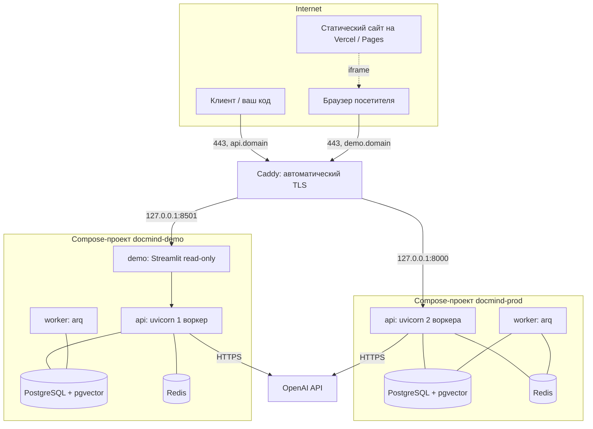

# DocMind — полный runbook: от пустого VPS до публичного демо

Единый пошаговый сценарий развёртывания **продакшен-API** и **публичной
демонстрации** на одном VPS, включая укрепление сервера, DNS, секреты,
GitHub, TLS, бюджет, мониторинг, бэкапы, откат и день-2-операции.

Этот документ — практика «сделай руками». Проектные решения и их обоснование
живут в [`docs/DEPLOYMENT.md`](DEPLOYMENT.md) (прод) и [`docs/DEMO.md`](DEMO.md)
(демо); здесь они собраны в одну линейную инструкцию.

> **Три правила, которые нельзя нарушать нигде.**
> 1. Секреты (`.env`, `.env.demo`, приватные ключи, `OPENAI_API_KEY`) живут
>    только на сервере и в GitHub Secrets. Никогда в репозитории и никогда в
>    issue/логах.
> 2. Наружу смотрят только 80/443. Порты `8000`, `8001`, `8501`, `5432`, `6379`
>    привязаны к loopback и не открываются в фаерволе.
> 3. Демо-контур никогда не использует продовые секреты и продовую БД.

## Соглашения этого гайда

| Плейсхолдер | Значение |
| --- | --- |
| `<domain>` | ваш домен, например `example.com` |
| `api.<domain>` | публичный адрес продового API |
| `demo.<domain>` | публичный адрес демо-UI |
| `<VPS_IP>` | IPv4 вашего сервера |
| `deploy` | непривилегированный пользователь на сервере |
| `/opt/docmind` | каталог прод-контура (совпадает с `DEPLOY_PATH` в GitHub) |
| `/opt/docmind-demo` | каталог демо-контура (отдельный `DEPLOY_PATH`) |

Команды выполняются на сервере, если не указано иное. Всё, где нужны права
root, помечено `sudo`.

---

# Часть 0. Что должно получиться



| Что | Где слушает | Кто видит |
| --- | --- | --- |
| Прод-API | `127.0.0.1:8000` (loopback) | интернет через `api.<domain>` |
| Прод-DB/Redis | только Docker-сеть `docmind-prod_default` | никто снаружи |
| Демо-API | `127.0.0.1:8001` (loopback) | никто: UI ходит к нему изнутри |
| Демо-UI | `127.0.0.1:8501` (loopback) | интернет через `demo.<domain>` |
| Демо-DB/Redis | только Docker-сеть `docmind-demo_default` | никто снаружи |

---

# Часть 1. Требования и планирование ресурсов

## 1.1. Что понадобится

- **VPS**: 2 vCPU / 4 ГБ RAM минимум для прода. Прод + демо вместе требуют
  около **7–8 ГБ** в худшем случае (см. ниже), поэтому либо берите 8 ГБ, либо
  ужмите лимиты в [`docker-compose.demo.yml`](../docker-compose.demo.yml).
- **Диск**: 20 ГБ минимум. Считайте: образы (~1.5 ГБ), тома Postgres и uploads,
  локальные бэкапы (5 последних дампов), логи Caddy.
- **ОС**: Ubuntu 22.04/24.04 LTS или Debian 12.
- **Домен** с возможностью создавать A/AAAA-записи.
- **GitHub**: административный доступ к репозиторию (создание environments,
  secrets, variables).
- **Ключ OpenAI** с ограниченным бюджетом.
- **GHCR**: приватный пакет тянется с VPS по PAT.

## 1.2. Бюджет памяти

| Сервис | Лимит в compose | Комментарий |
| --- | --- | --- |
| prod `api` | 2 ГБ, 2 CPU | [`docker-compose.prod.yml`](../docker-compose.prod.yml) |
| prod `worker` | 2 ГБ, 2 CPU | там же |
| prod `db` | 2 ГБ, 2 CPU | там же |
| prod `redis` | 512 МБ | там же |
| demo `api` | 1 ГБ, 1 CPU | [`docker-compose.demo.yml`](../docker-compose.demo.yml) |
| demo `worker` | 1 ГБ, 1 CPU | там же |
| demo `db` | 1 ГБ, 1 CPU | там же |
| demo `redis` | 256 МБ | там же |
| demo `demo` (UI) | 512 МБ | там же |

Итого худший случай: **~10.3 ГБ**. Практика: Postgres/Redis редко добирают
лимит, и реальное потребление обычно в 1.5–2 раза ниже. Тем не менее:

- При 4 ГБ — сначала поднимите прод, измерьте `docker stats`, и только потом
  ужимайте демо (`api` 512 МБ, `worker` 512 МБ, `db` 512 МБ, UI 384 МБ).
- Добавьте swap (см. шаг 6 части 2): он не спасёт от OOM-циклов, но сгладит пики.

## 1.3. Схема выбора провайдера

| Провайдер | Плюсы | Цена |
| --- | --- | --- |
| `openai` | не требует RAM, быстрый, минимум настройки | платит за трафик: обязателен лимит бюджета |
| `ollama` | нет денежных расходов, данные не уходят | +8 ГБ RAM, slow first-token, `EMBEDDING_DIM=768` и своя БД |

Для публичного демо с ограниченным бюджетом разумная комбинация: **прод и демо
на OpenAI**, но с разными ключами доступа и жёстким лимитом в кабинете.

---

# Часть 2. Первичная настройка VPS (шаги 1–8)

## Шаг 1. Первый вход и обновление системы

```bash
ssh root@<VPS_IP>
apt update && apt full-upgrade -y
apt install -y curl git ufw fail2ban unzip ca-certificates jq
timedatectl set-timezone Europe/Budapest        # или ваш пояс
```

Проверьте, что включены только нужные сервисы, и перезагрузитесь, если ядро
обновилось:

```bash
[ -f /var/run/reboot-required ] && reboot
```

## Шаг 2. Пользователь `deploy` и SSH-ключ

```bash
adduser --gecos "" deploy
usermod -aG sudo deploy
```

На **вашей машине** сгенерируйте ключ для входа:

```bash
ssh-keygen -t ed25519 -C "docmind-admin" -f ~/.ssh/docmind_admin -N ""
ssh-copy-id -i ~/.ssh/docmind_admin.pub deploy@<VPS_IP>
ssh deploy@<VPS_IP>     # проверьте вход
```

## Шаг 3. Ужесточение SSH

**Не закрывайте текущую сессию**, пока не убедились, что новый вход работает.

```bash
sudo tee /etc/ssh/sshd_config.d/99-hardening.conf >/dev/null <<'EOF'
PermitRootLogin no
PasswordAuthentication no
PubkeyAuthentication yes
KbdInteractiveAuthentication no
X11Forwarding no
MaxAuthTries 3
LoginGraceTime 20
EOF
sudo sshd -t && sudo systemctl reload ssh
```

Проверка из **нового** терминала: `ssh deploy@<VPS_IP>` должен пустить,
`ssh root@<VPS_IP>` — отказать.

## Шаг 4. Фаервол

```bash
sudo ufw default deny incoming
sudo ufw default allow outgoing
sudo ufw allow OpenSSH
sudo ufw allow 80/tcp
sudo ufw allow 443/tcp
sudo ufw allow 443/udp      # только если включите HTTP/3 в Caddy
sudo ufw enable
sudo ufw status verbose
```

> Порт 8000 и 8001 **не открываются никогда**: они привязаны к loopback и
> доступны только процессам на самом сервере.

## Шаг 5. Защита от перебора

```bash
sudo tee /etc/fail2ban/jail.d/sshd.local >/dev/null <<'EOF'
[sshd]
enabled = true
maxretry = 4
findtime = 10m
bantime  = 1h
EOF
sudo systemctl enable --now fail2ban
sudo fail2ban-client status sshd
```

Автоматические обновления безопасности:

```bash
sudo dpkg-reconfigure --priority=low unattended-upgrades
```

## Шаг 6. Swap

```bash
sudo fallocate -l 4G /swapfile
sudo chmod 600 /swapfile
sudo mkswap /swapfile
sudo swapon /swapfile
echo '/swapfile none swap sw 0 0' | sudo tee -a /etc/fstab
free -h
```

Для 8+ ГБ RAM хватит 2 ГБ. Значение `vm.swappiness=10` уменьшит ненужный обмен.

## Шаг 7. Docker Engine и Compose

```bash
sudo install -m 0755 -d /etc/apt/keyrings
curl -fsSL https://download.docker.com/linux/ubuntu/gpg \
  | sudo gpg --dearmor -o /etc/apt/keyrings/docker.gpg
sudo chmod a+r /etc/apt/keyrings/docker.gpg
echo "deb [arch=$(dpkg --print-architecture) signed-by=/etc/apt/keyrings/docker.gpg] \
https://download.docker.com/linux/ubuntu $(. /etc/os-release && echo $VERSION_CODENAME) stable" \
  | sudo tee /etc/apt/sources.list.d/docker.list >/dev/null
sudo apt update
sudo apt install -y docker-ce docker-ce-cli containerd.io \
  docker-buildx-plugin docker-compose-plugin
sudo usermod -aG docker deploy
```

Выйдите и войдите заново (чтобы применилась группа `docker`), затем проверьте:

```bash
docker --version && docker compose version
docker run --rm hello-world
```

**Ротация логов на уровне демона** (compose-файлы уже задают её на сервис, это
страховка для чужих контейнеров):

```bash
sudo tee /etc/docker/daemon.json >/dev/null <<'EOF'
{
  "log-driver": "json-file",
  "log-opts": { "max-size": "10m", "max-file": "3" }
}
EOF
sudo systemctl restart docker
```

## Шаг 8. Утилиты для эксплуатации

```bash
sudo apt install -y rclone postgresql-client-16 || sudo apt install -y rclone postgresql-client
```

- `rclone` — выгрузка бэкапов off-host (подключается через `BACKUP_SYNC_CMD`).
- `psql` на хосте удобен для ручных проверок БД, но не обязателен: compose умеет
  `exec -T db psql`.

Опционально:

```bash
git config --global user.email "ops@<domain>"
git config --global user.name "DocMind Ops"
```

---

# Часть 3. DNS

Создайте записи у регистратора/в DNS-провайдере:

| Тип | Имя | Значение | TTL |
| --- | --- | --- | --- |
| A | `api` | `<VPS_IP>` | 300 |
| A | `demo` | `<VPS_IP>` | 300 |
| AAAA | `api` / `demo` | IPv6, если есть | 300 |

Проверка:

```bash
dig +short api.<domain>
dig +short demo.<domain>
```

> **Порядок важен.** Caddy выпускает сертификат через ACME (HTTP-01/TLS-ALPN),
> поэтому DNS должен разрешаться **до** первого запуска Caddy, а 80/443 — быть
> открыты. Иначе получите ошибку выпуска и временный запрет от Let's Encrypt.

---

# Часть 4. Каталоги

```bash
sudo mkdir -p /opt/docmind /opt/docmind-demo/corpus
sudo chown -R deploy:deploy /opt/docmind /opt/docmind-demo
```

Каталог логов Caddy здесь **не** создаётся: пользователь `caddy` появляется
только после установки пакета (часть 10).

Почему два каталога: каждый контур имеет **свой `DEPLOY_PATH`**, свой env-файл,
свой state-файл и свои бэкапы. Смешивание каталогов — единственная ошибка,
которая может привести к тому, что демо-деплой перезапишет файлы прод-деплоя.

---

# Часть 5. Серверный `.env` для прода

## 5.1. Генерация секретов

```bash
openssl rand -hex 32     # пароль Postgres
openssl rand -hex 32     # пароль Redis
openssl rand -hex 48     # API_KEY (общий секрет API)
```

Сохраните их в менеджере паролей: они невосстановимы.

## 5.2. Создание файла

```bash
cd /opt/docmind
umask 077
nano .env
```

```dotenv
# --- PostgreSQL ---
POSTGRES_USER=docmind
POSTGRES_PASSWORD=<сгенерированный-пароль-32-байта>
POSTGRES_DB=docmind

# --- Redis ---
REDIS_PASSWORD=<сгенерированный-пароль-32-байта>

# --- API ---
API_KEY=<сгенерированный-ключ-48-байт>
ENVIRONMENT=production
ENABLE_DOCS=False
METRICS_ENABLED=True
LOG_JSON=True
LOG_LEVEL=INFO
CORS_ORIGINS=https://app.<domain>

# --- Провайдер ---
EMBEDDING_PROVIDER=openai
LLM_PROVIDER=openai
EMBEDDING_DIM=1536
OPENAI_API_KEY=<ключ-провайдера>

# --- Опционально ---
# MAX_UPLOAD_MB=25
# LLM_REASONING_EFFORT=none
# RATE_LIMIT_WINDOW_SECONDS=60
# UPLOAD_RATE_LIMIT_REQUESTS=10
# CHAT_RATE_LIMIT_REQUESTS=30
# DB_POOL_SIZE=10
# DB_MAX_OVERFLOW=10
# FORWARDED_ALLOW_IPS=172.16.0.0/12
# BACKUP_SYNC_CMD=rclone copy --no-transfer
```

Затем:

```bash
chmod 600 /opt/docmind/.env
grep -c '=' /opt/docmind/.env     # санити-чек: файл не пустой
```

## 5.3. Правила, которые проверяет система

| Правило | Кто проверяет | Последствие нарушения |
| --- | --- | --- |
| `API_KEY` обязателен | [`src/config.py`](../src/config.py) | API откажется стартовать |
| `CORS_ORIGINS` не `*` в проде | [`src/config.py`](../src/config.py) | API откажется стартовать |
| `EMBEDDING_DIM` совпадает с моделью **и** миграцией | [`src/db/schema_guard.py`](../src/db/schema_guard.py) | отказ на старте, а не порча данных |
| `DATABASE_URL`/`REDIS_URL` не `localhost` | [`remote-deploy.sh`](../.github/deploy/remote-deploy.sh) | rollout прекращается до изменений |
| `POSTGRES_PASSWORD` и т.п. обязательны | [`docker-compose.prod.yml`](../docker-compose.prod.yml) | `docker compose` не запустится |

## 5.4. Пул подключений к БД

Формула из README: `(воркеры API + 1) * (DB_POOL_SIZE + DB_MAX_OVERFLOW) < max_connections`.

Прод: 2 воркера + 1 arq-workker = `3 * (10 + 10) = 60` < `max_connections=100`.
Если поднимаете воркеры — уменьшайте пул или увеличивайте `max_connections`
(в Postgres по умолчанию 100, в pgvector-образе тоже).

---

# Часть 6. GitHub: ключ, PAT, environments

## 6.1. Ключ для деплоя

На **вашей машине**:

```bash
ssh-keygen -t ed25519 -C "github-actions-deploy" -f ~/.ssh/docmind_deploy -N ""
ssh-copy-id -i ~/.ssh/docmind_deploy.pub deploy@<VPS_IP>
cat ~/.ssh/docmind_deploy      # приватный ключ → в GitHub Secret SSH_KEY
```

### 6.1.1. Если у ключа есть парольная фраза

Ключ без пароля (`-N ""`, как выше) — предпочтительный вариант: его защищает
сам GitHub Secret, а `SSH_PASSPHRASE` не нужен вообще.

Если ключ всё же создан с парольной фразой, фраза хранится **отдельным**
секретом, а не внутри `SSH_KEY`:

```bash
gh secret set SSH_PASSPHRASE --env production
gh secret set SSH_PASSPHRASE --env demo
```

`Deploy Production` и `Deploy Demo` передают его в `appleboy/scp-action` и
`appleboy/ssh-action` через вход `passphrase`. Без этого секрета `drone-scp`
устанавливает TCP-соединение и определяет ОС сервера, но аутентифицироваться не
может:

```
ssh.ParsePrivateKey: ssh: this private key is passphrase protected
ssh: handshake failed: ssh: unable to authenticate, attempted methods [none],
no supported methods remain
```

`attempted methods [none]` — важная деталь: список методов аутентификации пуст,
то есть ключ не загрузился вообще. Сервер здесь ни при чём, `authorized_keys`
тоже: до сверки ключа дело не доходит.

Проверить пару «ключ + фраза» до пуша:

```bash
ssh-keygen -y -P "$SSH_PASSPHRASE" -f ~/.ssh/docmind_deploy > /tmp/docmind.pub
ssh-keygen -lf /tmp/docmind.pub        # отпечаток, который должен быть на сервере
```

На VPS: `ssh-keygen -lf ~/.ssh/authorized_keys` — отпечатки обязаны совпасть.
То же самое печатает диагностический шаг `Validate SSH deploy key` в обоих
workflow, так что сверять можно прямо по логу Actions.

## 6.2. Токен для GHCR

Создайте **Personal Access Token**:

- classic: scope `read:packages`;
- или fine-grained: доступ к Packages (read).

`GHCR_USER` — ваш GitHub-логин, `GHCR_PULL_TOKEN` — сам токен. На VPS он
используется только для `docker login ghcr.io` и `docker pull`.

## 6.3. Environment `production`

| Kind | Name | Value |
| --- | --- | --- |
| Environment | `production` | Required reviewers: вы/команда (ручной approve) |
| Secret | `SSH_HOST` | `<VPS_IP>` |
| Secret | `SSH_USER` | `deploy` |
| Secret | `SSH_KEY` | приватный ключ целиком, с `-----BEGIN…/END…-----` |
| Secret | `SSH_PASSPHRASE` | парольная фраза к `SSH_KEY`; **не нужен**, если ключ без пароля |
| Secret | `SSH_PORT` | `22` (или ваш) |
| Secret | `DEPLOY_PATH` | `/opt/docmind` |
| Secret | `GHCR_USER`, `GHCR_PULL_TOKEN` | доступ к приватному образу |
| Variable | `PRODUCTION_URL` | `https://api.<domain>` |

## 6.4. Environment `demo`

| Kind | Name | Value |
| --- | --- | --- |
| Environment | `demo` | **без** required reviewers |
| Secret | `SSH_HOST`, `SSH_USER`, `SSH_KEY`, `SSH_PORT` | те же доступы |
| Secret | `SSH_PASSPHRASE` | фраза от **демо**-ключа; секреты контуров не переиспользуются |
| Secret | `DEPLOY_PATH` | `/opt/docmind-demo` |
| Secret | `GHCR_USER`, `GHCR_PULL_TOKEN` | те же |
| Variable | `DEMO_URL` | `https://demo.<domain>` |

> Если `SSH_HOST` не задан, job падает с явной ошибкой, а не пропускает деплой
> молча. Если `DEPLOY_PATH` демо укажет на `/opt/docmind`, демо-rollout начнёт
> управлять прод-стеком — это единственная конфигурационная ошибка, реально
> ломающая прод.

---

# Часть 7. Первый релиз образов

## 7.1. Локальные гейты перед merge

```bash
make install      # python -m pip install -e ".[dev,demo]" + pre-commit hooks
make check        # ruff + ruff format --check + mypy + pytest с порогом 60%
```

## 7.2. Что запустит CI

[`ci.yml`](../.github/workflows/ci.yml) на каждый PR:

- **lint**: `ruff check` и `ruff format --check`;
- **typecheck**: `mypy src`;
- **test**: `pytest --cov=src --cov-fail-under=60`;
- **migrations-and-integration**: `alembic upgrade head`, `alembic check`
  (детект дрейфа схемы) и `pytest -m integration` на живом pgvector.

Плюс [`security.yml`](../.github/workflows/security.yml) (CodeQL, pip-audit,
gitleaks, Trivy FS) и [`dependency-review.yml`](../.github/workflows/dependency-review.yml).

## 7.3. Публикация образов

```bash
git checkout main && git pull
git tag v1.0.0
git push origin v1.0.0
```

Запускаются два независимых workflow:

| Workflow | Образ | Гейт |
| --- | --- | --- |
| [`release-image.yml`](../.github/workflows/release-image.yml) | `ghcr.io/<owner>/<repo>` | Trivy HIGH/CRITICAL, SBOM + provenance |
| [`release-demo-image.yml`](../.github/workflows/release-demo-image.yml) | `ghcr.io/<owner>/<repo>-demo` | тот же гейт, но отдельным workflow |

Разделение сделано специально: CVE в Streamlit-стеке не должен блокировать
релиз продакшена. Тег `sha-<full-sha>` (`type=sha,format=long`) есть у обоих
образов — по нему деплои резолвят диджест.

Если Trivy-гейт упал: смотрите отчёт в логах job, обновите зависимость или
базовый образ, затем перезапустите workflow. Не отключайте гейт — digest-пиннинг
защищает только от подмены, а не от уязвимого кода.

---

# Часть 8. Первый деплой прода

1. Откройте Actions → **Deploy Production**.
2. Если это запуск после релиза — нажмите **Review deployments → Approve**.
   Либо запустите вручную (`workflow_dispatch`) и укажите `image_tag`
   (например `sha-<full-sha>` или `v1.0.0`).
3. Что произойдёт на сервере ([`remote-deploy.sh`](../.github/deploy/remote-deploy.sh)):

| Этап | Действие | Почему |
| --- | --- | --- |
| 0 | Отказ, если `DATABASE_URL`/`REDIS_URL` указывают на localhost | иначе контейнер пойдёт в свой loopback и упадёт |
| 1 | `docker login`, `docker pull`, резолв диджеста `repo@sha256:...` | неизменяемая ссылка вместо mutable-тега |
| 2 | `compose up -d --wait db redis` | backing-сервисы должны быть healthy |
| 3 | Обязательный `pg_dump` в `backups/predeploy-*.sql` | без бэкапа миграции не применяются |
| 3b | `--profile ollama` + `ollama-init` | только если выбран Ollama |
| 4 | `alembic upgrade head` **один раз**, вне старта контейнера | рестарт не может изменить схему |
| 5 | `compose up -d --no-build api worker` | переключение трафика |
| 5a | Ожидание `/health` до 36 попыток × 5 с = 3 минуты | иначе автооткат |
| 5b | `POST_DEPLOY_CMD`, если задан | у прода пусто; у демо — seed |
| 6 | Запись тега в `.deployed_image_tag` | основа для откатa |

4. **Первый деплой**: предыдущего тега нет, автооткат недоступен — об это
   скрипт пишет в лог явно. Держите SSH-сессию под рукой.

Ожидаемые строки в логе: `deploying ghcr.io/...@sha256:...`,
`database backed up to backups/predeploy-...sql`, `applying database migrations`,
`health check passed`.

---

# Часть 9. Верификация прода

```bash
cd /opt/docmind
set -a; . ./.env; set +a          # подхватить переменные из .env в текущую сессию

curl -fsS http://127.0.0.1:8000/health | jq .
```

Ожидаемые поля ([`src/schemas/meta.py`](../src/schemas/meta.py)):

```json
{"status":"healthy","database":true,"redis":true,"version":"1.0.0",
 "environment":"production","provider_ready":true}
```

`status` может быть `degraded` (тогда ответ 503) — это значит, что не отвечает
Postgres или Redis.

Проверка авторизации и данных:

```bash
# без ключа — 401
curl -sS -o /dev/null -w '%{http_code}\n' http://127.0.0.1:8000/api/v1/documents

# с ключом — 200 и список
curl -fsS -H "X-API-Key: $API_KEY" http://127.0.0.1:8000/api/v1/documents | jq .

# метрики читаются с самого хоста
curl -fsS http://127.0.0.1:8000/metrics | head -n 20

# версия задеплоенного образа
cat .deployed_image_tag
docker compose -f docker-compose.prod.yml ps
```

Сквозной тест (загрузка → индексация → чат):

```bash
printf 'DocMind — RAG-сервис для документов. Тестовый документ.\n' > /tmp/sample.txt

DOC_ID=$(curl -fsS -H "X-API-Key: $API_KEY" \
  -F "file=@/tmp/sample.txt" \
  http://127.0.0.1:8000/api/v1/documents/upload | jq -r .id)
echo "$DOC_ID"

# ждём, пока статус станет completed
watch -n 3 "curl -fsS -H 'X-API-Key: $API_KEY' \
  http://127.0.0.1:8000/api/v1/documents/$DOC_ID/status | jq '{status, chunk_count}'"

# потоковый ответ: токены должны появляться постепенно, а не одним блоком
curl -sSN -H "X-API-Key: $API_KEY" -H 'Content-Type: application/json' \
  -d "{\"query\":\"О чём этот документ?\",\"document_ids\":[\"$DOC_ID\"]}" \
  http://127.0.0.1:8000/api/v1/chat/completions
```

Уберите тестовый документ, чтобы он не попал в прод-корпус:

```bash
curl -fsS -X DELETE -H "X-API-Key: $API_KEY" \
  http://127.0.0.1:8000/api/v1/documents/$DOC_ID
```

---

# Часть 10. Caddy: TLS и vhosts

## 10.1. Установка

```bash
sudo apt install -y debian-keyring debian-archive-keyring apt-transport-https
curl -1sLf 'https://dl.cloudsmith.io/public/caddy/stable/gpg.key' \
  | sudo gpg --dearmor -o /usr/share/keyrings/caddy-stable-archive-keyring.gpg
curl -1sLf 'https://dl.cloudsmith.io/public/caddy/stable/debian.deb.txt' \
  | sudo tee /etc/apt/sources.list.d/caddy-stable.list
sudo apt update && sudo apt install -y caddy
```

## 10.2. Конфигурация

Сначала — каталог логов: Caddy стартует под пользователем `caddy`, который
появляется лишь после установки пакета, и без прав на этот каталог сервис не
поднимется.

```bash
sudo mkdir -p /var/log/caddy
sudo chown caddy:caddy /var/log/caddy
```

Возьмите [`deploy/caddy/Caddyfile.example`](../deploy/caddy/Caddyfile.example)
как основу:

```bash
sudo cp /opt/docmind/deploy/caddy/Caddyfile.example /etc/caddy/Caddyfile   # если файл есть на сервере
sudo nano /etc/caddy/Caddyfile
```

Замените: `email` на реальный, `api.example.com` → `api.<domain>`,
`demo.example.com` → `demo.<domain>`. Ключевые моменты конфига:

| Блок | Зачем |
| --- | --- |
| `request_body { max_size 30MB }` | чуть выше `MAX_UPLOAD_MB=25`, иначе multipart-обёртка срежет валидный файл |
| `handle /health` | публичный проб без ключа |
| `handle /metrics` + `remote_ip` | `/metrics` отдаётся **без авторизации** — наружу нельзя |
| `handle /api/v1/chat/completions` + `flush_interval -1` | без этого SSE придёт одним блоком в конце |
| `header_up X-Forwarded-For {remote_host}` | **перезапись**, а не append: иначе клиент подделает свой IP и обойдёт rate limit |
| demo vhost: `read_timeout 0` | WebSocket Streamlit не должен умирать по таймауту |
| demo vhost: нет `X-Frame-Options` | страница встраивается в iframe на сайте |

## 10.3. Запуск и проверка

```bash
sudo caddy validate --config /etc/caddy/Caddyfile
sudo systemctl enable --now caddy
sudo systemctl reload caddy
sudo journalctl -u caddy -n 50 --no-pager
```

Проверки:

```bash
curl -sSI https://api.<domain>/health | head -n 3
curl -sS  https://api.<domain>/health | jq .
curl -sS -o /dev/null -w '%{http_code}\n' https://api.<domain>/metrics    # ждём 404
curl -sS -o /dev/null -w '%{http_code}\n' \
  -H "X-API-Key: $API_KEY" https://api.<domain>/api/v1/documents          # ждём 200
```

Проверка, что реальный IP клиента доходит до приложения: попросите кого-то
снаружи вызвать API и убедитесь, что в JSON-логе Caddy `client_ip` — его адрес,
а не `127.0.0.1`.

## 10.4. Если сертификат не выпускается

| Симптом | Причина |
| --- | --- |
| `no such host` / NXDOMAIN | A-запись не создана или не разошлась |
| `connection refused` | 80/443 закрыты в `ufw` или у провайдера |
| `rate limited` | слишком много попыток за 7 дней: подождите или используйте staging CA |
| Валидный ответ, но предупреждение о сертификате | сертификат ещё получается; проверьте `journalctl -u caddy` |

---

# Часть 11. Демо-контур

## 11.1. Подготовка

```bash
mkdir -p /opt/docmind-demo/corpus
# положите 2–3 документа, которые не жалко показать публично
cp /path/to/*.pdf /opt/docmind-demo/corpus/
ls -la /opt/docmind-demo/corpus
```

Поддерживаются `.txt`, `.md`, `.csv`, `.json`, `.pdf`
([`src/services/parser.py`](../src/services/parser.py)).

## 11.2. Свой `.env.demo`

```bash
cd /opt/docmind-demo
umask 077
nano .env.demo
```

```dotenv
# --- PostgreSQL (собственная БД!) ---
POSTGRES_USER=docmind_demo
POSTGRES_PASSWORD=<отдельный-пароль>
POSTGRES_DB=docmind_demo

# --- Redis ---
REDIS_PASSWORD=<отдельный-пароль>

# --- API: КЛЮЧ ДОЛЖЕН ОТЛИЧАТЬСЯ ОТ ПРОДОВОГО ---
API_KEY=<отдельный-ключ-демо>

CORS_ORIGINS=https://demo.<domain>
DOCMIND_PUBLIC_API_URL=https://demo.<domain>

EMBEDDING_PROVIDER=openai
LLM_PROVIDER=openai
EMBEDDING_DIM=1536
OPENAI_API_KEY=<ключ-провайдера-для-демо>

ENABLE_DOCS=False
METRICS_ENABLED=True

# --- Защита бюджета и корректные лимиты ---
RATE_LIMIT_WINDOW_SECONDS=60
CHAT_RATE_LIMIT_REQUESTS=5
UPLOAD_RATE_LIMIT_REQUESTS=10
FORWARDED_ALLOW_IPS=172.16.0.0/12

DOCMIND_DEMO_MAX_QUESTION_CHARS=500
DOCMIND_DEMO_TOP_K=4
SEED_WAIT_SECONDS=180
```

```bash
chmod 600 /opt/docmind-demo/.env.demo
```

## 11.3. Деплой демо

Автоматически после успешного `Release Demo Image`, либо вручную:
Actions → **Deploy Demo** → Run workflow → `image_tag`.

Порядок шагов — тот же, но с другими параметрами:

| Параметр | Демо |
| --- | --- |
| `COMPOSE_FILE` | `docker-compose.demo.yml` |
| `ENV_FILE` | `.env.demo` |
| `STATE_FILE` | `.deployed_demo_image_tag` |
| `BACKUP_DIR` | `backups-demo` |
| `HEALTH_URL` | `http://localhost:8001/health` |
| `TRAFFIC_SERVICES` | `api worker demo` |
| `POST_DEPLOY_CMD` | `docker compose -f docker-compose.demo.yml --profile seed run --rm demo-seed` |

## 11.4. Проверка демо

```bash
cd /opt/docmind-demo
set -a; . ./.env.demo; set +a

curl -fsS http://127.0.0.1:8001/health | jq .
curl -fsS http://127.0.0.1:8501/_stcore/health && echo "  UI ok"
curl -fsS -H "X-API-Key: $API_KEY" http://127.0.0.1:8001/api/v1/documents \
  | jq -r '.[] | "\(.filename)\t\(.status)\t\(.chunk_count) chunks"'
```

В браузере: `http://127.0.0.1:8501` — должен появиться список документов и таб
чата; загрузки быть не должно.

## 11.5. Ручной seed и обновление корпуса

После добавления файлов:

```bash
cd /opt/docmind-demo
docker compose -f docker-compose.demo.yml --profile seed run --rm demo-seed
```

Скрипт идемпотентен: уже проиндексированные по имени файла документы он
пропускает и ждёт перехода каждого нового в `completed`.

## 11.6. Полный сброс демо

```bash
cd /opt/docmind-demo
docker compose -f docker-compose.demo.yml down
docker volume rm docmind-demo_demo_pg_data docmind-demo_demo_uploads
# следующий деплой создаст схему заново и наполнит корпус
```

---

# Часть 12. Встраивание демо на сайт

```html
<iframe
  src="https://demo.<domain>/?embed=true"
  title="DocMind live demo"
  width="100%"
  height="820"
  style="border: 1px solid #d9d9d9; border-radius: 8px"
  loading="lazy"
  referrerpolicy="strict-origin-when-cross-origin"
  allow="clipboard-write"
></iframe>
<p>
  Демонстрация не отображается?
  <a href="https://demo.<domain>/" target="_blank" rel="noopener">Откройте в новой вкладке</a>.
</p>
```

Правила и подводные камни:

- `?embed=true` убирает внешние отступы Streamlit. Проверьте на своей версии.
- Всегда оставляйте запасную ссылку: корпоративные прокси, блокировщики и CSP
  родительской страницы ломают iframe, и это не ваша ошибка.
- HTTPS обязателен с обеих сторон: сайт по HTTPS не встроит HTTP-фрейм.
- Если нужно ограничить, кто встраивает, задайте в Caddy
  `frame-ancestors 'self' https://<ваш-сайт>` вместо удаления защиты.
- Загрузка файлов в UI **отсутствует**, вопросы ограничены
  `DOCMIND_DEMO_MAX_QUESTION_CHARS`.

Как проверить руками:

1. Откройте `https://demo.<domain>/` напрямую — список документов виден.
2. Выберите документ, задайте вопрос — ответ приходит по токенам, видны источники.
3. Задайте вопрос длиннее 500 символов — должно появиться предупреждение.
4. Откройте страницу своего сайта во фрейме — интерфейс помещается, не обрезан.
5. Отключите cookies/жёстко перезагрузите — сессия поднимается заново.

---

# Часть 13. Доказательство изоляции контуров

Выполните после первого демо-деплоя — все четыре проверки должны пройти:

```bash
set -a; . /opt/docmind/.env; set +a
set -a; . /opt/docmind-demo/.env.demo; set +a

# 1. Демо-ключ отвергается продовым API и наоборот
curl -sS -o /dev/null -w 'demo→prod: %{http_code}\n' \
  -H "X-API-Key: $API_KEY" http://127.0.0.1:8000/api/v1/documents
```

Аккуратнее: два `.env` перетирают переменную `API_KEY`. Проверяйте так:

```bash
PROD_KEY=$(grep -E '^API_KEY=' /opt/docmind/.env | cut -d= -f2-)
DEMO_KEY=$(grep -E '^API_KEY=' /opt/docmind-demo/.env.demo | cut -d= -f2-)

# один ключ не работает на чужом контуре — оба должны вернуть 401
curl -sS -o /dev/null -w 'prod-ключ → demo-API: %{http_code}\n' \
  -H "X-API-Key: $PROD_KEY" http://127.0.0.1:8001/api/v1/documents
curl -sS -o /dev/null -w 'demo-ключ → prod-API: %{http_code}\n' \
  -H "X-API-Key: $DEMO_KEY" http://127.0.0.1:8000/api/v1/documents

# 2. Разные Compose-проекты и разные тома
docker ps --format '{{.Names}}' | sort
docker volume ls | grep docmind
docker network ls | grep docmind

# 3. Ни один API-порт не опубликован наружу
sudo ss -tlnp | grep -E ':(8000|8001|8501|5432|6379)\b'
# все строки должны быть с 127.0.0.1

# 4. Перезапуск демо не задел прод: время старта контейнеров прода не меняется
docker compose -f /opt/docmind/docker-compose.prod.yml ps
docker compose -f /opt/docmind-demo/docker-compose.demo.yml ps
```

---

# Часть 14. Бюджет, абьюз, безопасность

## 14.1. Деньги провайдера

1. В кабинете OpenAI задайте **hard spend limit** на проект.
2. Включите e-mail-уведомления о расходе.
3. Держите `LLM_REASONING_EFFORT=none` (дефолт проекта): это и дешевле, и быстрее.
4. Для демо используйте более дешёвую модель, задав `LLM_MODEL` в `.env.demo`.

Помните: лимитер в приложении ([`src/api/deps.py`](../src/api/deps.py)) —
**процесс-локальный** и только сглаживает пики. Настоящий потолок расходов —
настройка аккаунта провайдера.

## 14.2. Лимиты запросов

| Параметр | Прод | Демо | Смысл |
| --- | --- | --- | --- |
| `RATE_LIMIT_WINDOW_SECONDS` | 60 | 60 | окно |
| `CHAT_RATE_LIMIT_REQUESTS` | 30 | 5 | чат на клиента за окно |
| `UPLOAD_RATE_LIMIT_REQUESTS` | 10 | 10 | загрузки (в демо их делает только seed) |

Два важных нюанса:

- Лимит **на процесс**. Прод с `--workers 2` даёт фактически ×2. Демо работает
  с одним воркером, чтобы задокументированное число совпадало с реальным.
- Ключ лимита — адрес TCP-соединения. За прокси это docker-gateway, поэтому
  прод/демо задают `FORWARDED_ALLOW_IPS`, а Caddy **перезаписывает**
  `X-Forwarded-For`. Если поставить прокси, который заголовок дописывает,
  клиент сможет подделать IP и обойти лимит.

Для жёсткого глобального лимита: `caddy-ratelimit` или CDN/WAF перед демо.

## 14.3. Гигиена секретов

- `.env`, `.env.demo`, `.deployed_*`, `backups*`, `*.pem`, `*.key` уже в
  [`.gitignore`](../.gitignore); проверку на утечку делает gitleaks в
  [`security.yml`](../.github/workflows/security.yml).
- Ротация `API_KEY`: сгенерируйте новый, обновите `.env` (или `.env.demo`),
  затем перезапустите только `api worker` — миграции не требуются.
- Ротация `POSTGRES_PASSWORD`: меняется и в `.env`, и в самой БД
  (`ALTER USER ... PASSWORD`), затем перезапуск `api worker`.
- Приватные ключи деплоя не переиспользуйте между контурами: если ключ утёк,
  в GitHub достаточно заменить `SSH_KEY` и убрать старый из `authorized_keys`.

---

# Часть 15. Мониторинг и алерты

## 15.1. Что мониторить

| Что | Откуда | Тревога, если |
| --- | --- | --- |
| Живость | `GET /health` (внешний монитор) | не 200 дольше 3 минут |
| Готовность | `docmind_ready` == 1 | 0 больше минуты |
| Ошибки чата | `docmind_chat_streams_total{outcome="error"}` | доля ошибок растёт |
| Индексация | `docmind_ingestion_jobs_total{outcome="failed"}` | есть рост |
| Задержки | `docmind_http_request_duration_seconds` | p95 растёт |
| Ресурсы | `docker stats`, `df -h` | диск > 80% |
| Расходы | кабинет провайдера | приближение к лимиту |

Имена метрик — из [`src/metrics.py`](../src/metrics.py): `docmind_http_requests_total`,
`docmind_http_request_duration_seconds`, `docmind_chat_streams_total`,
`docmind_ingestion_jobs_total`, `docmind_ready`, `docmind_app_info`.

## 15.2. Быстрые команды

```bash
# состояние и логи
docker compose -f /opt/docmind/docker-compose.prod.yml ps
docker compose -f /opt/docmind/docker-compose.prod.yml logs --since 30m api
docker compose -f /opt/docmind/docker-compose.prod.yml logs --since 30m worker
sudo journalctl -u caddy --since "30 min ago"

# метрики (только с хоста или из приватной сети)
curl -fsS http://127.0.0.1:8000/metrics | grep -E 'docmind_(ready|chat|ingestion)'

# ресурсы
docker stats --no-stream
df -h /var/lib/docker
```

## 15.3. Внешний мониторинг

- Поднимите Uptime Kuma / Healthchecks на другом хосте и проверяйте
  `https://api.<domain>/health` (он публичный по дизайну и не требует ключа).
- Prometheus-скрейп `/metrics` настройте по loopback или из приватной сети —
  снаружи он закрыт Caddy.
- Логи: JSON на stderr, собирайте `journalctl`/`docker logs` через свой стек.
  Корреляция запросов — по заголовку `X-Request-ID`, который генерирует
  [`src/main.py`](../src/main.py).

---

# Часть 16. Бэкапы и восстановление

## 16.1. Что уже автоматизировано

Перед каждым деплоем rollout делает **обязательный** `pg_dump`:

```bash
ls -lh /opt/docmind/backups/ | tail
# predeploy-20261016T120000Z.sql
```

Дамп **не сжат** — это обычный SQL. Хранятся последние `KEEP_BACKUPS=5`.
Если `pg_dump` упал, деплой прерывается: миграции без страховки не применяются.

## 16.2. Off-host копия

Настройте rclone (`rclone config`) и добавьте в `.env`:

```dotenv
BACKUP_SYNC_CMD=rclone copy --no-traverse
```

Скрипт выполнит `rclone copy --no-traverse <backup_file>` — файл уедет в
настроенный remote. Проверьте это явно, иначе «бэкап есть» останется надеждой.

## 16.3. Ручной бэкап

```bash
cd /opt/docmind
set -a; . ./.env; set +a
mkdir -p backups
docker compose -f docker-compose.prod.yml exec -T db \
  sh -c 'pg_dump -U "$POSTGRES_USER" "$POSTGRES_DB"' \
  > "backups/manual-$(date -u +%Y%m%dT%H%M%SZ).sql"
ls -lh backups | tail -n 3
grep -c 'CREATE TABLE' backups/manual-*.sql | tail -n 1   # убедиться, что дамп не пустой
```

## 16.4. Восстановление

Дамп содержит `CREATE TABLE` без `DROP`, поэтому восстановление идёт в **чистую**
базу. План:

```bash
cd /opt/docmind
set -a; . ./.env; set +a
BACKUP=backups/predeploy-20261016T120000Z.sql

# 1. Остановить трафик, чтобы никто не писал во время восстановления
docker compose -f docker-compose.prod.yml stop api worker

# 2. Пересоздать базу
docker compose -f docker-compose.prod.yml exec -T db \
  sh -c 'psql -U "$POSTGRES_USER" -d postgres -c "DROP DATABASE IF EXISTS \"$POSTGRES_DB\" WITH (FORCE);"'
docker compose -f docker-compose.prod.yml exec -T db \
  sh -c 'psql -U "$POSTGRES_USER" -d postgres -c "CREATE DATABASE \"$POSTGRES_DB\";"'

# 3. Восстановить схему и данные (дамп НЕ сжат — gunzip не нужен)
docker compose -f docker-compose.prod.yml exec -T db \
  sh -c 'psql -U "$POSTGRES_USER" -d "$POSTGRES_DB"' < "$BACKUP"

# 4. Поднять стек и убедиться, что схема на месте
docker compose -f docker-compose.prod.yml up -d --no-build api worker
curl -fsS http://127.0.0.1:8000/health | jq .
```

Если расширение `vector` не создалось автоматически, включите его от
суперпользователя и повторите пункт 3:

```bash
docker compose -f docker-compose.prod.yml exec -T db \
  sh -c 'psql -U "$POSTGRES_USER" -d "$POSTGRES_DB" -c "CREATE EXTENSION IF NOT EXISTS vector;"'
```

Восстановление демо-контура — те же команды с `-f docker-compose.demo.yml`,
`/opt/docmind-demo` и `backups-demo`.

## 16.5. Учебная тревога

Раз в квартал: поднимите тестовый Postgres, восстановите последний дамп,
убедитесь, что `alembic current` совпадает с ожидаемой ревизией и что API
стартует против восстановленной базы. Бэкап без проверки восстановления —
это не бэкап.

---

# Часть 17. Обновления, миграции, откат

## 17.1. Обычный релиз

1. Смёржили PR в `main` (CI должен быть зелёным).
2. `Release Image` собрал и опубликовал образ (и `Release Demo Image` — свой).
3. Actions → `Deploy Production` → **Approve**.
4. Rollout: бэкап → миграции → рестарт `api worker` → health → state.
5. Демо подтянется автоматически (`Deploy Demo`), затем выполнится seed.

## 17.2. Миграции: только expand/contract

Схема **не откатывается** вместе с образом. Правило: каждый релиз должен быть
совместим и со старой, и с новой версией схемы.

| Плохо | Хорошо |
| --- | --- |
| Переименовать колонку в одном релизе | Добавить новую → писать в обе → перенести данные → убрать старую в следующем релизе |
| Добавить `NOT NULL` без дефолта | Добавить с дефолтом, затем убрать дефолт |
| Удалить таблицу, пока жив старый код | Сначала выкатить код без обращений, потом удалять |

Проверяйте локально: `alembic upgrade head && alembic check` — то же делает CI.

## 17.3. Автоматический откат

Если `/health` не поднялся за 3 минуты, скрипт попытается вернуть предыдущий
тег из `.deployed_image_tag` — **но только если** этот образ знает текущую
ревизию БД (`alembic history` содержит её). Иначе он откажется и попросит
ручного вмешательства: откат «вслепую» превратит API в crash-loop.

## 17.4. Ручной откат

```bash
# вариант 1: перезапустить rollout на предыдущем теге
# Actions → Deploy Production → Run workflow → image_tag: <предыдущий-тег>

# вариант 2: на сервере
cd /opt/docmind
# посмотреть, что было задеплоено
cat .deployed_image_tag
# отредактировать state и перезапустить сервисы вручную
echo "<предыдущий-тег>" > .deployed_image_tag
```

Откат **схемы** возможен только восстановлением дампа (см. часть 16) плюс
выкатка старого образа. Поэтому бэкап перед каждым деплоем безусловен.

## 17.5. Откат демо

То же самое, но: `DEPLOY_PATH=/opt/docmind-demo`, state-файл
`.deployed_demo_image_tag`, бэкапы в `backups-demo`. Откат демо не влияет на прод.

---

# Часть 18. Регулярные операции

## 18.1. Что происходит само

- **Dependabot**: PR по pip / actions / docker.
- **Weekly Trivy**: [`security.yml`](../.github/workflows/security.yml).
- **APT_CACHE_BUST**: при каждом релизе пересобирается apt-слой, поэтому образ
  не тянет старые патчи Debian.
- **Pre-deploy backup**: перед каждой миграцией.
- **Retention бэкапов**: хранится последние 5.

## 18.2. Что делать руками

| Периодичность | Действие |
| --- | --- |
| Еженедельно | просмотреть PR Dependabot; `docker system df`; проверить алерты |
| Ежемесячно | `sudo apt upgrade -y`, перезагрузка при обновлении ядра; `docker image prune -f`; проверить свободное место |
| Ежеквартально | восстановление дампа на тестовом контейнере; ротация `API_KEY`; ротация PAT GHCR |
| При инциденте | ротация затронутых секретов; аудит `journalctl`/логов Caddy по `X-Request-ID` |

## 18.3. Обслуживание диска

```bash
df -h
docker system df
docker image prune -f          # безопасно: уберёт неиспользуемые образы
docker builder prune -f        # кэш сборки
ls -lh /opt/docmind/backups /opt/docmind-demo/backups-demo
```

> `docker volume prune` **не запускайте**: он может удалить `docmind-prod_pg_data`.
> Для удаления тома указывайте имя явно, как в разделе про сброс демо.

---

# Приложение A. Шпаргалка команд

```bash
# --- Прод ---
cd /opt/docmind
set -a; . ./.env; set +a
docker compose -f docker-compose.prod.yml ps
docker compose -f docker-compose.prod.yml logs -f api
docker compose -f docker-compose.prod.yml restart api worker
curl -fsS http://127.0.0.1:8000/health | jq .

# --- Демо ---
cd /opt/docmind-demo
set -a; . ./.env.demo; set +a
docker compose -f docker-compose.demo.yml ps
docker compose -f docker-compose.demo.yml --profile seed run --rm demo-seed
curl -fsS http://127.0.0.1:8001/health | jq .

# --- Caddy ---
sudo caddy validate --config /etc/caddy/Caddyfile
sudo systemctl reload caddy && sudo journalctl -u caddy -n 30 --no-pager

# --- Публичные проверки ---
curl -sS https://api.<domain>/health | jq .
curl -sS -H "X-API-Key: $API_KEY" https://api.<domain>/api/v1/documents | jq .
curl -sSI https://demo.<domain>/ | head -n 3
```

# Приложение B. Переменные окружения

| Переменная | Обязательна | Где | Назначение |
| --- | --- | --- | --- |
| `POSTGRES_USER/PASSWORD/DB` | да | оба `.env` | креды БД (compose их требует) |
| `REDIS_PASSWORD` | да | оба `.env` | включает `requirepass` |
| `API_KEY` | да в проде | оба `.env` | ключ всех `/api/v1/*`; в демо — отдельный |
| `EMBEDDING_DIM` | да | оба `.env` | ширина вектора; должен совпасть с моделью и миграцией |
| `CORS_ORIGINS` | да | оба `.env` | явный список, не `*` |
| `OPENAI_API_KEY` | при `openai` | оба `.env` | доступ к провайдеру |
| `ENVIRONMENT` | — | compose | `production` включает строгую политику |
| `ENABLE_DOCS` | — | оба `.env` | Swagger; в проде `False` |
| `METRICS_ENABLED` | — | оба `.env` | включает `/metrics` |
| `MAX_UPLOAD_MB` | — | оба `.env` | лимит файла (25 по умолчанию) |
| `LLM_MODEL` / `EMBEDDING_MODEL` | — | оба `.env` | переопределение модели |
| `LLM_REASONING_EFFORT` | — | оба `.env` | `none` по умолчанию: дешевле |
| `RATE_LIMIT_*` | — | оба `.env` | лимиты per-client |
| `FORWARDED_ALLOW_IPS` | — | compose | доверенные адреса для `X-Forwarded-For` |
| `DB_POOL_SIZE` / `DB_MAX_OVERFLOW` | — | оба `.env` | размер пула (см. формулу) |
| `BACKUP_SYNC_CMD` | — | прод | выгрузка бэкапов off-host |
| `DOCMIND_PUBLIC_API_URL` | да в демо | `.env.demo` | публичный origin демо |
| `DOCMIND_DEMO_MODE` | — | compose | read-only режим UI |
| `DOCMIND_DEMO_MAX_QUESTION_CHARS` | — | `.env.demo` | лимит длины вопроса |
| `DOCMIND_DEMO_TOP_K` | — | `.env.demo` | фиксированный `top_k` |
| `SEED_WAIT_SECONDS` | — | `.env.demo` | бюджет ожидания индексации |
| `TRAFFIC_SERVICES` | — | workflow | какие сервисы переключать |
| `POST_DEPLOY_CMD` | — | workflow | хук после health (seed) |

# Приложение C. Чек-листы

**Перед первым деплоем**

- [ ] `ufw` включён: только 22/80/443.
- [ ] Docker работает под `deploy` без sudo.
- [ ] A-записи `api.` и `demo.` разрешаются в `<VPS_IP>`.
- [ ] `/opt/docmind/.env` создан, `chmod 600`, `DATABASE_URL`/`REDIS_URL` не localhost.
- [ ] GitHub: environment `production` с ревьюерами, `SSH_*`, `GHCR_*`, `DEPLOY_PATH=/opt/docmind`.
- [ ] CI зелёный на `main`, образы опубликованы.
- [ ] Лимит расходов в кабинете провайдера задан.

**После каждого прод-деплоя**

- [ ] `/health` → `status: healthy`, `database: true`, `redis: true`.
- [ ] `/api/v1/documents` без ключа → 401, с ключом → 200.
- [ ] `.deployed_image_tag` совпадает с выкатанным тегом.
- [ ] В логах `api`/`worker` нет повторяющихся исключений.
- [ ] Новый бэкап появился в `backups/`.

**Перед публикацией ссылки на демо**

- [ ] UI открывается, документы видны, загрузки нет.
- [ ] Ответ стримится токенами, источники показываются.
- [ ] Вопрос длиннее лимита получает предупреждение.
- [ ] `/metrics` снаружи даёт 404.
- [ ] Демо-ключ не действует против прод-API (401).
- [ ] На iframe есть запасная ссылка.

**Квартально**

- [ ] Восстановление из дампа проверено на тестовом контейнере.
- [ ] Ротация `API_KEY` (прод и демо отдельно).
- [ ] Ротация GHCR PAT.
- [ ] `df -h` и `docker system df` в норме.
- [ ] Проверены алерты мониторинга (сработают ли на самом деле).

# Приложение D. Диагностика

| Симптом | Вероятная причина | Что делать |
| --- | --- | --- |
| Rollout: «DATABASE_URL points at localhost» | строка DSN в `.env` | удалите `DATABASE_URL`/`REDIS_URL`, оставьте `POSTGRES_*`/`REDIS_*` |
| `/health` → 503, `database: false` | БД не поднялась | `docker compose ps`, логи `db`, проверьте пароль |
| `/health` → 503, `provider_ready: false` | нет/неверный `OPENAI_API_KEY` | проверьте ключ и лимиты провайдера |
| API не стартует, в логах про `EMBEDDING_DIM` | рассинхрон модели, `.env` и миграции | приведите `EMBEDDING_DIM` в соответствие (openai → 1536) |
| `Can't locate revision` при старте | образ старше миграции БД | выкатите совместимый образ, иначе восстановите дамп |
| 401 на все вызовы | неверный/просроченный `API_KEY` | сверьте ключ в `.env` у демо/прода — они разные |
| 429 при обычной работе | per-client лимит | проверьте `FORWARDED_ALLOW_IPS` и заголовок `X-Forwarded-For` |
| SSE приходит одним блоком | прокси буферизует | в Caddy `flush_interval -1` на `/api/v1/chat/completions` |
| Демо: «corpus is still empty» | seed не выполнялся | запустите `--profile seed run --rm demo-seed` и посмотрите вывод |
| Seed: `... rate limited` | мало `UPLOAD_RATE_LIMIT_REQUESTS` | скрипт ждёт по `Retry-After`; поднимите лимит или подождите |
| Пустой iframe | фрейминг, CSP или mixed content | уберите `X-Frame-Options`, настройте `frame-ancestors`, используйте HTTPS |
| Caddy: 502 Bad Gateway | Caddy старше контейнеров | `docker compose ps`; дождитесь health, затем reload Caddy |
| ACME не выпускает сертификат | DNS/порты/лимиты CA | см. таблицу в части 10.4 |
| Диск заполнен | логи/образы/тома | `docker system df`, `journalctl --vacuum-size=200M`, prune образов |
| Worker не обрабатывает документы | Redis недоступен или падает задача | логи `worker`, `docmind_ingestion_jobs_total`, проверьте `REDIS_PASSWORD` |

# Приложение E. Сценарии аварий

**Полностью недоступен прод-API.** Caddy отдаёт 502 → `docker compose ps`;
проверьте `/health` на loopback; если контейнер в рестарт-цикле — логи, затем
ручной откат на предыдущий тег (часть 17.4).

**Испорчена схема/данные.** Остановите `api worker`, восстановите последний
дамп (часть 16.4), выкатите образ, совместимый с этой ревизией.

**Утёк `API_KEY`.** Сгенерируйте новый, обновите `.env` (и `.env.demo` отдельно),
перезапустите `api worker`. Старый ключ немедленно перестанет работать. Если
утекло у демо — поменяйте только его, прод не трогайте.

**Утёк ключ провайдера.** Отзовите его в кабинете, создайте новый, обновите
`OPENAI_API_KEY` в обоих `.env`, перезапустите `api worker`.

**Демо атакуют / расходы растут.** Понизьте `CHAT_RATE_LIMIT_REQUESTS`, при
необходимости временно остановите UI (`docker compose -f docker-compose.demo.yml stop demo`) —
API при этом останется для seed — и разбирайтесь по логам Caddy (`client_ip`,
`X-Request-ID`). Прод при этом не затронут.

**Упал диск VPS.** Поднимите новый сервер, повторите части 2–5, восстановите
дампы из off-host хранилища, задеплойте тот же тег из `.deployed_image_tag`.
DNS-переключение — единственное, что нужно поменять снаружи.
